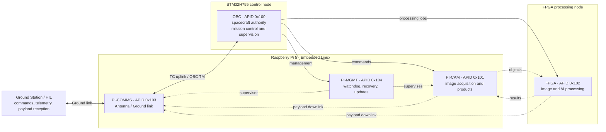

    

# EXN — Modular Satellite Avionics Demonstration Platform

**EXN** is an ExoSpaceLabs project for building and validating a modular Earth-observation spacecraft architecture. It connects a spacecraft **on-board computer (OBC)**, Linux-based payload services, FPGA image/AI processing, and a Ground Station/HIL environment through a common **CCSDS Space Packet / ECSS PUS Revision C** interface.

EXN is both a practical integration demonstrator and the **single source of truth for its system architecture and Interface Control Documents (ICDs)**. This repository defines the system and its mission-visible interfaces; the [component repositories](#implementation-repositories) implement them.

## Logical system

**Solid connections** represent command, supervision, and Ground-link relationships. **Dashed connections** represent service supervision or payload-data handoffs. They describe logical paths, not separate physical cables.

The OBC is **spacecraft authority**: it owns mission/platform state, command authorization, time, health supervision, fault detection/isolation/recovery (FDIR), and payload orchestration. Subordinate devices execute assigned work. This extends to future AOCS/ADCS, EPS and thermal controllers, even though those subsystems are not implemented in the current EXN stage.

The Pi has **two mission roles on one computer**: Camera (PI-CAM) and Antenna/Ground communications (PI-COMMS). PI-MGMT is a supporting Linux management endpoint, not a third mission role. The FPGA is a payload **processing** resource, not a second Ground-communications node.

See [system architecture](docs/architecture.md) for the physical deployment, authority model, extensibility and control/data-plane diagrams.

## How EXN works

**Commands follow OBC authority.** In the flight-like topology, Ground telecommands enter through the Pi Antenna service and reach the OBC. The OBC validates and authorizes operations, then directs Camera, FPGA, Antenna or PI-MGMT as needed. Ground/HIL can connect directly to an OBC or simulator without changing this logical authority model.

**Bulk payload bytes do not have to pass through the OBC.** Camera can capture an image, the FPGA can process it, and the chosen product can reach Ground through the Antenna service. The OBC decides *what* may be transferred and *where*, while the producing endpoint and Antenna move the bulk bytes.

**Housekeeping is spacecraft-wide.** The OBC maintains a cache of its own and subordinate endpoints' heartbeat, health and sensor telemetry, supervises missing devices, and records recovery decisions. Ground requests one System-HK snapshot with `TC[3,128]` and receives `TM[3,129]`; detailed operational flows are in [sequence diagrams](docs/diagrams.md).

**Mission interfaces use PUS Revision C.** Standard services handle verification, HK, events, time, monitoring and runtime parameters. Mission-specific services handle Camera configuration/acquisition, processing jobs, payload objects and software management. The [service profile](docs/services.md) defines their meaning and where they run. Its [high-level service map](docs/services.md#service-deployment-map) provides the service-by-endpoint view without crowding this introduction.

## Documentation guide

| Read this | For |
|---|---|
| [System architecture](docs/architecture.md) | Logical and physical deployment, spacecraft authority, control/data paths, transport and software composition |
| [Interaction diagrams](docs/diagrams.md) | Ground commands, System HK, fault recovery, acquisition, processing, downlink and updates |
| [PUS service profile and deployment map](docs/services.md) | Service purpose, ownership, standard vs mission-specific allocations |
| [Common component/service contract](docs/component-services.md) | Shared behavior, states, HK/recovery, time, transfer and software lifecycle |
| [Master ICD](docs/ICD.md) | CCSDS/PUS-C packet layout, APIDs, routing and wire rules |
| [Endpoint ICD index](docs/icd/README.md) | Ground, OBC, Camera, Antenna/PI-MGMT and FPGA-specific interfaces |
| [Hardware HK/sensors](docs/icd/hardware-sensors.md) | STM32H755, Raspberry Pi 5 and Kria K26/KV260 sensor IDs, units and availability |
| [Shared interface artifacts](interfaces/) | CCSDSPack templates, JSON tooling mirrors and MCU C definitions |

> [!IMPORTANT]
> **This repository owns the complete EXN ICD.** Component implementations may document their internal design, but they must not independently redefine APIDs, PUS service/subservice numbers, payloads, control IDs, HK layouts, events, routing semantics or recovery protocols. Interface changes start here and propagate to implementations.

## Implementation repositories

| Repository | Responsibility |
|---|---|
| [exn-gs](https://github.com/ExoSpaceLabs/exn-gs) | Ground Station and hardware-in-the-loop simulator |
| [exn-mcu-rtos](https://github.com/ExoSpaceLabs/exn-mcu-rtos) | STM32 OBC / control software |
| [exn-pi-cam](https://github.com/ExoSpaceLabs/exn-pi-cam) | Raspberry Pi 5 Camera, Antenna and platform management services |
| [exn-fpga-ai](https://github.com/ExoSpaceLabs/exn-fpga-ai) | FPGA payload-processing endpoint |

Reusable building blocks are [CCSDSPack](https://github.com/ExoSpaceLabs/CCSDSPack) (packet/PUS library, **v2.0.0**), [HardRT](https://github.com/ExoSpaceLabs/hardrt) (STM32 runtime, **0.5.1**), [DAS](https://github.com/Inczert/device-abstraction-stack) (device abstraction, **v0.1.0**), and optionally [SpWKit](https://github.com/ExoSpaceLabs/spwkit) (logical transport, **v0.7.0**). Their integration boundaries are described in [system architecture](docs/architecture.md). SpWKit is optional, and independent/private FPGA SpaceWire products are outside EXN scope.

## Current status

The **architecture and central PUS-C ICD are defined**, and the EXN-GS/HIL PUS-C integration baseline is implemented and tested. The STM32 OBC, dual-role Pi payload services and FPGA processing software still require implementation and end-to-end system validation against that contract.

The STM32H755 is an **OBC architecture demonstrator**, not a flight-qualified or radiation-tolerant spacecraft computer. Future platform functions such as AOCS/ADCS, EPS and thermal control remain under OBC authority but deliberately have no detailed implementation/interface allocation at this stage.

See [integration tracking](https://github.com/ExoSpaceLabs/exn/issues/6) for remaining component, interoperability and qualification work.

## License

Apache License 2.0. See [LICENSE](LICENSE).
