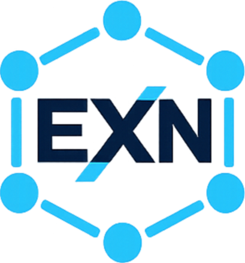
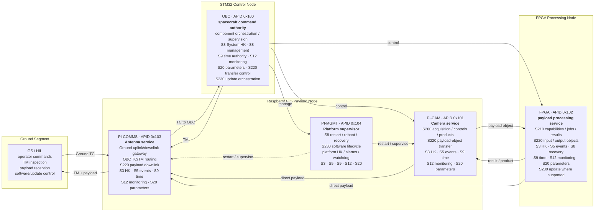

<div style="text-align: center;">
    
</div>

# EXN — Modular Satellite Avionics Demonstration Platform

**EXN** is an ExoSpaceLabs system-integration project for demonstrating a modular Earth-observation avionics and payload architecture across an **STM32 control computer**, an **Embedded Linux payload platform**, an **FPGA processing node**, and a **ground/HIL environment**.

The platform exercises realistic spacecraft engineering boundaries: CCSDS/ECSS packet interfaces, embedded supervision, image acquisition, hardware-accelerated image/AI processing, Ground communications, telemetry/telecommand workflows, flexible payload-data routing, and end-to-end integration testing.

The detailed logical architecture is defined in [docs/architecture.md](docs/architecture.md). **This repository owns the complete EXN ICD and mission interface definition**: [docs/ICD.md](docs/ICD.md) defines the common wire contract, [docs/services.md](docs/services.md) defines the PUS service profile, [docs/component-services.md](docs/component-services.md) defines the complete service behavior, and [docs/icd/](docs/icd/) contains the endpoint-specific ICDs.

> [!IMPORTANT]
> EXN is the **single system architecture and ICD authority**, not a monolithic firmware repository. **All mission-visible interfaces are defined here first.** Component repositories implement these definitions and may document implementation details, but they shall not independently assign APIDs, services/subservices, packet layouts, control/parameter IDs, HK structures, event IDs, routing semantics, timing rules, or update protocols.

## System Scope

EXN separates responsibilities across independently testable logical components:

- **STM32 Control Node / OBC:** system supervision, command/telemetry handling, health and fault management, time distribution, configuration, and control-plane routing/orchestration.
- **Raspberry Pi 5 Payload Node:** one physical Embedded Linux computer with **two first-class mission roles**.
  - **Camera role / PI-CAM:** image acquisition, payload-product ownership, storage/preparation, compression, and image transfer.
  - **Antenna role / PI-COMMS:** the Pi provides the spacecraft Ground link. The Antenna service exchanges TCs/TMs with the OBC and sends payload data from PI-CAM or FPGA to Ground without routing those bulk bytes through the OBC.
  - **Platform Management / PI-MGMT:** local Linux watchdog/supervision, service health, restart/reboot and software-update lifecycle supporting both mission roles; this is infrastructure, not a third Pi mission purpose.
- **FPGA Processing Node:** hardware-accelerated image preprocessing, inference, postprocessing, and other payload computation. The FPGA is a processing node in EXN, not a communications product.
- **Ground/HIL:** operator tooling, command/telemetry inspection, subsystem simulation, fault injection, and integration validation.

In the initial EXN deployment, **Camera and Antenna execute on the same Raspberry Pi 5**. They remain separate logical endpoints and services because they have different mission responsibilities, even though one physical Pi performs both roles. A later deployment may split them across computers without changing the interfaces.

## High-Level Service Map

The diagram below shows **where each EXN service lives and what it is responsible for**. Service numbers refer to the active **PUS Revision C** mission profile.



**Common service meaning:** Service 1 provides request verification; Service 3 housekeeping/heartbeat; Service 5 events; Service 8 function/recovery management; Service 9 time; Service 12 monitoring/alarms; **Service 20 is only runtime/persistent configuration parameters**; Service 200 Camera control; Service 210 FPGA processing; Service 220 payload-object transfer; Service 230 software management. Detailed purpose, ownership, examples and exclusions for every service are defined in [docs/services.md](docs/services.md).

The key ownership rule is deliberately simple: **OBC decides, Camera acquires, FPGA processes, Antenna talks to Ground, and PI-MGMT keeps the Pi services alive and updateable.** Bulk payload bytes may flow directly from Camera or FPGA to Antenna without passing through the OBC.

## Routing Model

EXN distinguishes the **control plane** from the **bulk data plane**.

The nominal flight-like command path is:

```text
Ground -> Antenna -> STM32 OBC -> selected payload endpoint
```

The current HIL environment may still connect the Ground Station directly to the MCU. That is a deployment profile, not a change of command authority.

Bulk payload data does not need to pass through the MCU. **Direct to Ground** means the producing payload endpoint sends the data to the Pi Antenna service, which transmits it over the Ground link; it does not mean bypassing the spacecraft antenna. Valid flows include:

```text
Camera -> Antenna -> Ground
Camera -> FPGA -> Camera -> Antenna -> Ground
FPGA -> Antenna -> Ground
FPGA -> OBC
```

The **FPGA result destination is controllable**. A processing result may be routed to the OBC for autonomous decision-making, back to the Camera service for product ownership/storage, or to the Antenna service for immediate Ground downlink. Multiple destinations are allowed when policy requires them.

The exact wire encoding of per-job processing-result routing will be introduced through the corresponding Service 210/interface revision. The architectural requirement is already fixed: the FPGA must not impose one hard-coded result path.

## Repository Role

This repository contains the **complete system specification and ICD set** rather than component implementations. A component interface is not considered defined until it exists here.

```text
exn/
├── interfaces/             # Machine-readable/shared interface artifacts derived from the ICD
├── docs/
│   ├── ICD.md              # Common CCSDS/PUS wire contract
│   ├── services.md         # Standard + mission-specific PUS service allocation
│   ├── component-services.md # Complete cross-component service behavior and payloads
│   ├── icd/                # Endpoint-specific normative ICDs
│   ├── architecture.md
│   └── diagrams.md
├── CHANGELOG.md
├── LICENSE
└── README.md
```

### Interface ownership rule

The dependency direction is one-way:

```text
ExoSpaceLabs/exn
  architecture + full ICD + interface definitions
        |
        +--> exn-gs          implements Ground/HIL side
        +--> exn-mcu-rtos    implements OBC side
        +--> exn-pi-cam      implements Pi Camera/Antenna/PI-MGMT side
        +--> exn-fpga-ai     implements FPGA side
```

If implementation work discovers a missing field, command, parameter, sensor, state, or error case, the contract is updated **here first**, then the component implementation follows it. The component repository does not silently extend the protocol.

### Component repositories

- **[exn-gs](https://github.com/ExoSpaceLabs/exn-gs):** ground-control and hardware-in-the-loop environment.
- **exn-mcu-rtos:** STM32 control/flight-software component.
- **exn-pi-cam:** Raspberry Pi payload-node software. The repository name is historical; the target node has both PI-CAM and PI-COMMS responsibilities on the same Raspberry Pi 5.
- **exn-fpga-ai:** FPGA image-processing and AI-acceleration component.

### Reusable platform repositories

- **[CCSDSPack](https://github.com/ExoSpaceLabs/CCSDSPack):** CCSDS Space Packet / ECSS PUS packet library. Current released EXN baseline: **v2.0.0**.
- **[HardRT](https://github.com/ExoSpaceLabs/hardrt):** RTOS/runtime for STM32 scheduling, synchronization, timers, signalling and execution control. Current released baseline: **0.5.1**.
- **[DAS](https://github.com/Inczert/device-abstraction-stack):** MCU/device/board abstraction layer for STM32H755 / NUCLEO-H755ZI-Q. Current released baseline: **v0.1.0**.
- **[SpWKit](https://github.com/ExoSpaceLabs/spwkit):** optional SpaceWire-style transport/simulation toolkit for logical EXN links. Current released baseline: **v0.7.0**.

Private/commercial FPGA SpaceWire implementation repositories are **outside EXN scope**. The EXN FPGA node exists for payload image/AI processing. Reusing FPGA hardware for separate SpaceWire development is a different product/integration concern.

## Software and Platform Composition

The reusable libraries are composed by each EXN application; they do not form one ownership chain.

For the STM32 control node, the intended relationship is:

```text
                 exn-mcu-rtos
                      |
        +-------------+-------------+
        |             |             |
    CCSDSPack      HardRT         SpWKit
                                    |
                             transport provider
                                    |
                                   DAS
                                    |
                                STM32H755
```

HardRT and DAS are peers from the application point of view: HardRT owns runtime/scheduling primitives, while DAS owns hardware/device access. SpWKit must not depend directly on DAS; an embedded transport-provider implementation may use DAS below the SpWKit boundary.

## SpWKit and Logical Links

If adopted by an EXN deployment, SpWKit may model multiple independent logical links over a shared physical carrier such as Ethernet.

For example, one Ethernet network may carry logical relationships such as:

```text
Camera <-> OBC
Antenna <-> OBC
Camera <-> FPGA
Camera <-> Antenna
FPGA <-> Antenna
```

This allows the demonstrator to simulate more than one spacecraft link without requiring one physical cable for every logical endpoint pair.

Mission packet/service semantics remain above that transport choice.

## Interfaces and ICDs

- **System architecture:** [docs/architecture.md](docs/architecture.md)
- **Component/service contract:** [docs/component-services.md](docs/component-services.md)
- **PUS service profile:** [docs/services.md](docs/services.md)
- **Master wire-level ICD:** [docs/ICD.md](docs/ICD.md)
- **Complete endpoint ICD index:** [docs/icd/README.md](docs/icd/README.md)
- **Ground/HIL:** [docs/icd/gs.md](docs/icd/gs.md)
- **MCU control node:** [docs/icd/mcu-rtos.md](docs/icd/mcu-rtos.md)
- **Raspberry Pi payload node / Antenna service:** [docs/icd/linux-payload.md](docs/icd/linux-payload.md)
- **Pi camera service:** [docs/icd/pi-cam.md](docs/icd/pi-cam.md)
- **FPGA processing node:** [docs/icd/fpga-ai.md](docs/icd/fpga-ai.md)

### Packet/interface definitions

- CCSDSPack TeleCommands: [interfaces/ccsdspack/tc/](interfaces/ccsdspack/tc/)
- CCSDSPack TeleMetry: [interfaces/ccsdspack/tm/](interfaces/ccsdspack/tm/)
- JSON mirrors for tooling: [interfaces/json/](interfaces/json/)
- MCU header-only definitions: [interfaces/mcu-rtos/](interfaces/mcu-rtos/)

Wire-level and service changes must be made in this repository first and synchronized across its normative ICD documents and generated/shared artifacts. `docs/component-services.md` defines the target operational behavior for Camera, Antenna, OBC, FPGA and PI-MGMT; the endpoint ICDs freeze endpoint-specific IDs, fields, states, capabilities and payloads. Component repositories consume this contract and do not own parallel copies of it.

## Current implementation status

The architecture is ahead of the component implementations, deliberately:

| Area | Current state |
|---|---|
| System architecture / ICD | defined on PUS Revision C; implementation alignment in progress |
| CCSDSPack | released and qualified; v2.0.0 is the current released EXN baseline |
| EXN-GS / HIL | implementation is being migrated from its old PUS-A code path to the normative PUS-C profile |
| STM32 OBC | repository still requires implementation against HardRT + DAS |
| Raspberry Pi dual-role payload node | existing repository is legacy/experimental; target implementation must provide both PI-CAM and PI-COMMS on the same Pi 5 |
| FPGA processing | architecture defined; implementation repository remains a placeholder |
| HardRT | released 0.5.1 |
| DAS | released v0.1.0 for STM32H755 / NUCLEO-H755ZI-Q |
| SpWKit | released v0.7.0; optional EXN transport integration, not a mandatory architecture dependency |

**PUS Revision C is the only active EXN packet profile.** PUS-A remains historical implementation debt only; no new interface, test or component work shall extend it.

## Integration Direction

The current integration direction is:

1. use **PUS Revision C everywhere**; migrate the existing GS/HIL and simulator now rather than maintaining a PUS-A compatibility branch;
2. keep released CCSDSPack v2.0.0 as the reproducible dependency until a newer release is actually published and adopted;
3. keep the central ICD, CCSDSPack templates, JSON/tooling artifacts, MCU header and component implementations synchronized to the same PUS-C service catalogue;
4. bring the MCU application up on **HardRT 0.5.1 + DAS v0.1.0** against the central EXN ICD;
5. evolve the Pi repository from its camera-only legacy implementation into the dual-role Camera + Antenna node under PI-MGMT supervision;
6. keep the FPGA focused on image/AI processing with advertised capabilities and configurable result routing;
7. use direct producer -> Antenna payload paths where they avoid unnecessary MCU bulk traffic;
8. adopt **SpWKit v0.7.x** only where its logical-link/transport model improves EXN integration, and validate that integration explicitly;
9. restore complete PUS-C node-to-node HIL/system regression before freezing an EXN system release.

### Documentation quality rule

A service is not considered defined merely because it has a number and a title. Before freezing a service, the central ICD must explain its **purpose, owner/users, what belongs in it, what does not, message/subservice allocation, payloads, and error/state behavior**. Generic services such as Service 20 must include concrete examples so implementers do not have to infer what “parameter management” was supposed to mean.

## License

Apache License 2.0. See [LICENSE](LICENSE) for the authoritative terms.
