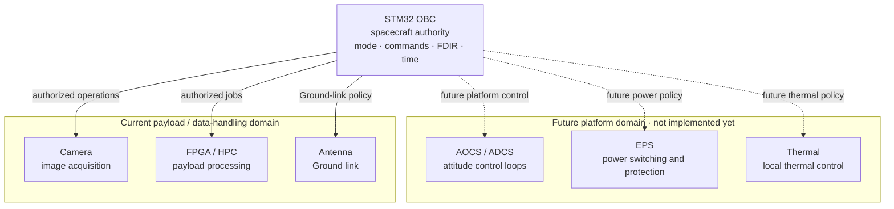
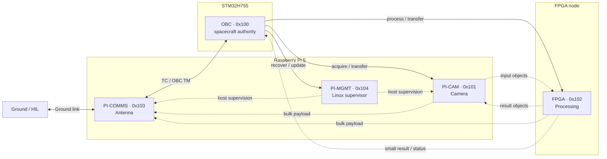
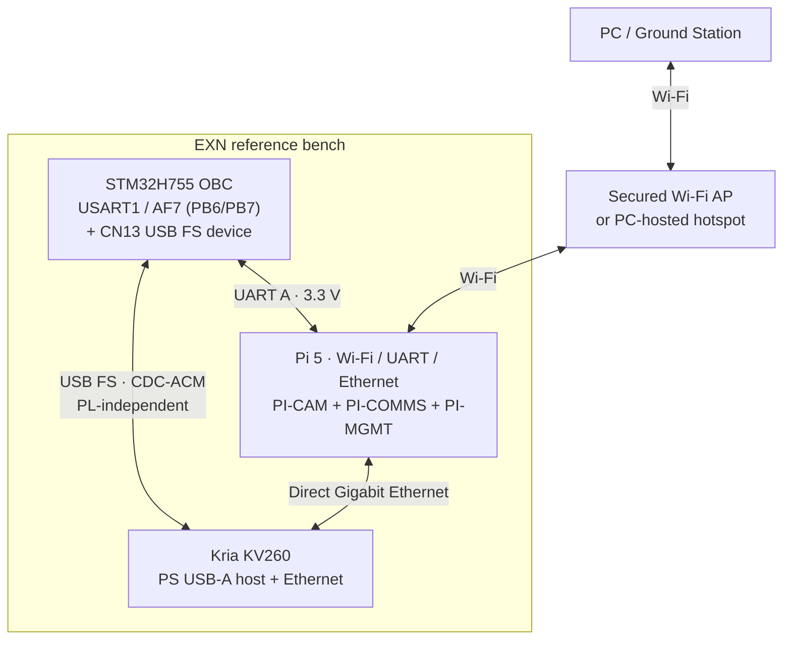
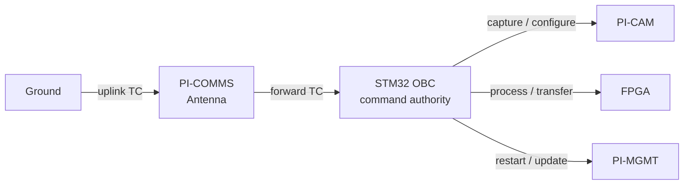
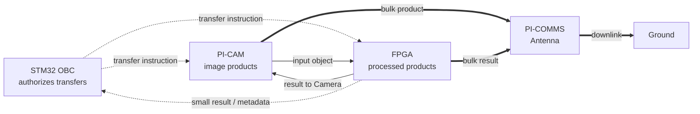
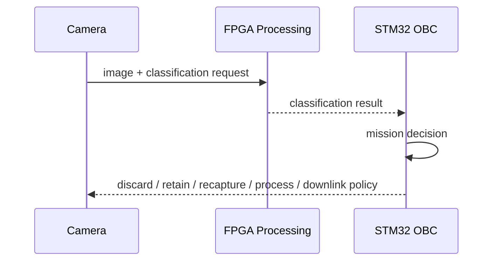
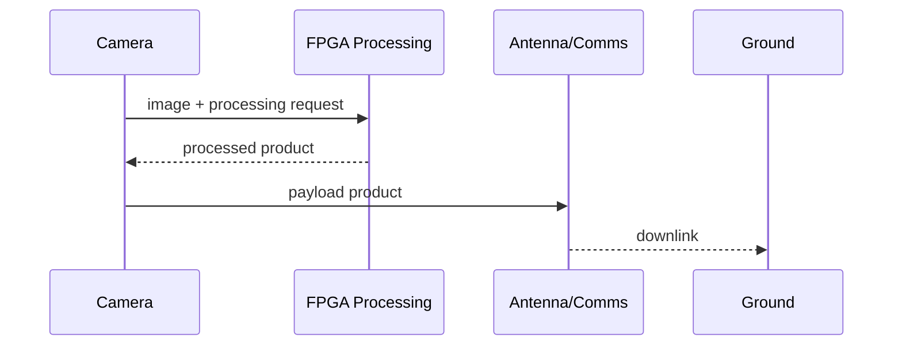
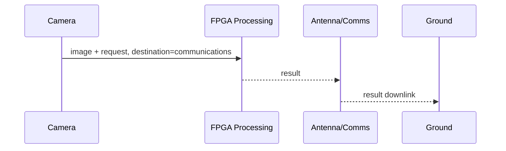

# EXN System Architecture

This document defines the logical EXN system architecture and the ownership boundaries between the control computer, Linux payload services, FPGA processing, ground communications, and reusable platform libraries.

The master wire-level contract remains [`docs/ICD.md`](ICD.md), [`docs/services.md`](services.md) defines the mission PUS service tailoring, and [`docs/component-services.md`](component-services.md) defines the complete endpoint behavior. This document describes how EXN components are intended to be composed and how control/data may flow between them without forcing one fixed mission pipeline. Representative time-ordered interactions live in [sequence diagrams](diagrams.md), while the detailed PUS-by-endpoint view is the [service deployment map](services.md#6-service-deployment-map).

## 1. Architectural principles

EXN is a modular avionics and payload demonstrator. The architecture intentionally separates **logical spacecraft endpoints** from the **physical computers** that currently host them.

The main rules are:

1. **STM32/OBC is the spacecraft platform authority.** It owns spacecraft mode, mission sequencing, command authorization/dispatch, time authority, spacecraft-wide supervision and FDIR. Platform and payload subsystems may execute local control/processing, but they remain subordinate to OBC authority.
2. **The Raspberry Pi 5 is a dual-role Embedded Linux payload node.** In the initial EXN deployment it performs both the Camera role and the Antenna role. Those roles are separate logical endpoints/services even though they share one physical computer.
3. **The FPGA is a processing node.** Its EXN role is image preprocessing, inference, postprocessing, and other hardware-accelerated payload computation.
4. **Processing results do not have one fixed destination.** The requester or mission policy selects where a result is delivered.
5. **Bulk payload data need not transit the MCU.** Control traffic should remain MCU-centric, while high-volume data paths may connect payload endpoints directly.
6. **Transport is below mission semantics.** Packet/service behavior must not depend on whether the current carrier is Ethernet, a simulated SpaceWire link, local Linux IPC, or a future physical transport.
7. **Reusable libraries remain independent projects.** EXN consumes CCSDSPack, HardRT, DAS, and optionally SpWKit. Their internal implementation scope is not part of the EXN mission architecture.
8. **PUS services are explicitly tailored.** CCSDSPack supplies the packet/header mechanisms; EXN defines which standard PUS services it realizes and which mission-specific services it adds. Service identifiers shall not be repurposed with unrelated semantics.

## Initial operating priority: OBC ↔ Pi Antenna / Ground

The reference hardware topology describes the **full** EXN constellation of components, not a mandatory all-devices-at-boot dependency. The first integrated operational milestone is **P0: PC/GS → Pi PI-COMMS (Antenna) → independently supervised Pi `exn-linkd` → STM32 OBC (HardRT CM7)**, with verification, HK and TM returning to Ground. PI-COMMS is the **highest implementation priority** because it is the spacecraft's sole initial Ground gateway; this is a delivery priority, not a new APID or a change to HardRT task-priority numbering.

The OBC kernel and its local safety/time/health mechanisms must boot even if Pi, USB or FPGA is missing. Ground commandability requires the configured Antenna/Wi-Fi/UART path to be present. The FPGA and USB CDC controller are modular **feature dependencies** of the later FPGA-enabled deployment only; neither DAS USB #37 nor KV260 firmware is a prerequisite for P0. PI-CAM and PI-MGMT are added independently after basic Antenna↔OBC communication, with PI-MGMT needed for later independent service-restart acceptance. Optional endpoints are explicitly configured; a deliberate omission is not an OFFLINE fault, while a configured endpoint that disconnects remains a fault.

See [staged profiles and presence rules](icd/inter-node-links.md#integration-deployment-profiles-and-priorities).

## OBC internal processing boundary

The STM32H755 implements **one OBC endpoint** (`0x100`) under CM7 spacecraft authority. Optional CM4 processing does not create an independently addressable EXN endpoint, command route or PUS identity. EXN defines only the OBC's externally observable services and behavior; **CM7↔CM4 job IPC, boot, HSEM, memory/cache allocation, scheduling and failure containment are private OBC contracts** documented in [exn-mcu-rtos's CM4 worker design](https://github.com/ExoSpaceLabs/exn-mcu-rtos/blob/main/docs/CM4_WORKER.md). Any change to externally visible OBC packets or behavior must be specified in EXN first.

## 1.1 Centralized authority, distributed execution

EXN distinguishes **authority** from **execution location**.

The OBC does not need to execute every algorithm itself. A future AOCS controller may run attitude estimation and high-rate wheel/torquer loops; an EPS controller may perform power switching/protection; a thermal controller may run heater loops; an HPC may perform image/AI processing. Those are distributed execution resources.

The OBC remains responsible for:

- spacecraft mode and safe-state ownership;
- mission/platform sequencing;
- telecommand authorization and dispatch;
- subsystem enable/disable and high-level set-points;
- health aggregation and FDIR;
- on-board time authority and distribution;
- platform-wide recovery decisions;
- deciding when payload products/processors may influence spacecraft actions.

A subsystem may autonomously protect itself locally, but it shall not independently redefine spacecraft mission state or safety policy.

The current EXN stage focuses on the payload/data-handling subset: Camera, Antenna, FPGA processing and Pi management. AOCS/ADCS, EPS, thermal and other platform subsystems are future scope and therefore intentionally lack detailed service ICDs today.



**Dashed connections** indicate planned platform subsystems, not deployed hardware. Even when a subordinate controller closes its own fast loop or performs independent local protection, spacecraft mission/safety authority remains with the OBC.

## 2. Logical system

The [README](../README.md#logical-system) introduces the primary endpoints. This more detailed view distinguishes **command authority and supervision (solid links)** from **payload/data handoffs and platform supervision (dashed links)**.



These are **permitted logical paths**, not a separate physical wire for each edge and not a mandatory fixed mission-processing pipeline.

## 3. Physical deployment

The selected **reference bench interconnect** is deliberately **switchless**:

- PC/GS to PI-COMMS over a secured Wi-Fi AP or PC hotspot;
- STM32 OBC to Pi 5 through an independent 3.3 V UART;
- STM32 OBC to Kria KV260 through the **STM32 CN13 USB Full-Speed CDC-ACM device**, with a KV260 **USB-A host** connected directly by USB-A-to-Micro-B data cable;
- Pi 5 to KV260 directly by a single Gigabit Ethernet cable for image transfers.



**No Ethernet switch, OBC TCP/IP stack or separate network adapter is required.** The Pi needs an independently supervised `exn-linkd` UART packet router so a PI-COMMS crash does not also block OBC access to PI-MGMT. The KV260 USB host uses the processing system and standard Linux CDC-ACM support, requiring no PL UART. The STM32 USB device firmware still needs implementing.

The Pi UART and KV260 USB CDC serial streams use COBS with `0x00` delimiter around complete PUS-C CCSDS packets; Pi↔KV260 Ethernet and Wi-Fi carry complete CCSDS packets over TCP. The two-host wired IP subnet is `10.77.0.0/30`; there is no Wi-Fi-to-Ethernet IP routing/NAT.

The [inter-device link ICD](icd/inter-node-links.md) defines the Pi UART pins, Nucleo CN13 power precautions, KV260 USB host/device roles, packet framing, deployment addresses and failure behavior. USB control remains dependent on the KV260 PS/Linux host; an independent hardware reset/power-control path is not provided.

Camera and Antenna remain **two first-class mission responsibilities of the same Raspberry Pi 5**, independently addressable through PI-CAM and PI-COMMS. PI-MGMT is their supporting platform-supervision endpoint. Physical host placement may change without changing their logical responsibility.

## 4. Raspberry Pi endpoint placement

The reference Pi hosts two **separate EXN mission components**, **PI-CAM** (`0x101`, acquisition/product owner) and **PI-COMMS** (`0x103`, Antenna/Ground gateway), plus **PI-MGMT** (`0x104`, an independently addressable supporting component). Physical co-location does **not** merge components or make their interaction an ungoverned private interface. The OBC remains command authority; payload bytes may transit directly between producers and PI-COMMS without passing through the OBC.

The **PI-CAM ↔ PI-COMMS component-to-component contract** is normative in [EXN component links](icd/component-links.md), including the Service 220 object handoff, identities, authorization and transfer outcomes, irrespective of their shared Linux host. The endpoint ICDs and link ICD define the remaining external interfaces. **Linux processes, `systemd` units, IPC encoding/transport, storage layout and data-copy optimization** are Pi-specific implementation decisions, documented in [exn-pi-cam](https://github.com/ExoSpaceLabs/exn-pi-cam/blob/main/docs/PI_NODE_ARCHITECTURE.md).

## 5. Control plane and data plane

EXN deliberately distinguishes the control plane from the bulk data plane.

### 5.1 Control plane

The OBC authorizes downstream operations even when the executor runs on a different processor or operating system.



The HIL deployment may connect the Ground tooling directly to a physical OBC or simulator. This changes transport topology, not command authority.

### 5.2 Data plane

Payload bytes may bypass the MCU as a **bulk-data router**, while the OBC still controls what may be transferred.



**Thick arrows** represent bulk payload delivery, **thin solid arrows** represent product handoffs, and **dashed arrows** represent control/metadata. The OBC owns the transfer decision, but it does not have to relay image bytes. Antenna remains the Ground-link endpoint.

## 6. FPGA processing and result routing

The FPGA is a **processing service**, not a fixed stage in a hard-coded `Camera -> FPGA -> Camera` pipeline.

A processing request conceptually contains:

```text
job identifier
processing/pipeline identifier
input reference or input stream
processing parameters
result destination(s)
delivery policy
```

The exact wire encoding of the routing fields is intentionally left to the Service 210/interface revision that implements this architecture. The architectural requirement is already fixed: **result routing must be controllable per processing request or by an explicitly configured mission policy.**

### 6.1 Typical destinations

A processing result may be routed to one or more of:

- **OBC**, for autonomous decisions, event generation, or subsequent commanding;
- **Camera service**, to associate the result with the source image, store it, or generate another payload product;
- **Antenna service**, which performs the actual Ground downlink;
- **requesting endpoint**, for request/response-style processing;
- **multiple endpoints**, when both control and payload consumers need the result.

### 6.2 Example: autonomous classification



A classification can therefore influence spacecraft behavior without requiring a full processed image to return through the MCU.

### 6.3 Example: processed payload product



### 6.4 Example: direct result downlink



Direct downlink is conditional on Antenna link availability and mission policy. The FPGA routes the result to the Antenna service; it does not own a Ground link itself. Loss of the Ground link must not make FPGA execution semantics depend on the ground station being present.

## 7. SpWKit in EXN

SpWKit may be used as a logical SpaceWire-style interconnect and simulation layer between EXN endpoints.

A useful deployment can expose Camera–OBC, Antenna–OBC, Camera–FPGA, Camera–Antenna and FPGA–Antenna logical links over one real Ethernet carrier. See the [shared-Ethernet logical-link diagram](diagrams.md#7-logical-links-over-shared-ethernet).

This lets EXN model multiple spacecraft communication relationships without requiring one physical cable per logical link.

SpWKit remains a reusable independent project. EXN should consume only the public transport/link behavior that it needs. **Commercial/private FPGA SpaceWire implementation repositories are outside EXN scope.** The EXN FPGA node is defined by its payload-processing role, not by any separate SpaceWire FPGA product.

How SpWKit is bound to DAS, HardRT or an endpoint-specific driver is **component implementation design**, not an EXN inter-device ICD requirement. See [OBC integration](https://github.com/ExoSpaceLabs/exn-mcu-rtos/blob/main/docs/INTEGRATION.md) and the respective library repositories.

## 8. PUS service architecture

EXN treats the PUS service catalogue as an application-interface layer above CCSDS packet construction and below endpoint mission logic.

The normative EXN wire profile is **PUS Revision C** as defined in [`ICD.md`](ICD.md) and [`services.md`](services.md). Any remaining PUS-A code in component repositories is migration debt and shall be replaced rather than extended.

The active service split is:

- standard Services **1, 3, 5, 8, 9, 12 and 20** for request verification, HK, events, function management, time, monitoring and runtime parameters;
- mission-specific Services **200, 210, 220 and 230** for Camera, processing, payload-object transfer and software management;
- standard Service **23** reserved for its PUS File Management meaning, not repurposed for image transfer.

The [service deployment map](services.md#6-service-deployment-map) contains the complete endpoint-by-service view.

This distinction is architectural, not cosmetic. A transport implementation such as SpWKit carries complete packet bytes and does not redefine PUS services; likewise, FPGA image-processing logic does not acquire communications-service ownership merely because it can physically emit results.

The central PUS-C service profile is the normative baseline for current and future endpoint implementations.

## 9. Implementation composition belongs to components

The EXN ICD describes **what devices exchange**, not how applications link DAS, HardRT, CCSDSPack or SpWKit, nor their thread/task/driver composition. Those reusable libraries remain independent of one another. The concrete library adapters, dependency graph, build flags, scheduling and firmware startup contracts belong in [OBC implementation](https://github.com/ExoSpaceLabs/exn-mcu-rtos/blob/main/docs/ARCHITECTURE.md), [Pi implementation](https://github.com/ExoSpaceLabs/exn-pi-cam/blob/main/docs/PI_NODE_ARCHITECTURE.md), [FPGA implementation](https://github.com/ExoSpaceLabs/exn-fpga-ai), and [Ground implementation](https://github.com/ExoSpaceLabs/exn-gs/blob/main/docs/architecture.md).

## 10. Interface ownership and change control

**This repository is the single normative home for system architecture and component-to-component interfaces, regardless of whether the components share hardware.** It owns endpoint/APID identities, CCSDS/PUS wire layouts, physical link allocation and framing, logical message/data contracts, routing and authority, command/telemetry semantics, shared parameter/event/sensor IDs, time/health/supervision and externally observable update/data-transfer behavior. See [component interaction ICD](icd/component-links.md).

| Owner | Documentation responsibility |
|---|---|
| `exn` | **Component-to-component** ICD, including co-located PI-CAM ↔ PI-COMMS, endpoint service and wire profiles, machine-readable `interfaces/` artifacts |
| `exn-mcu-rtos` | Internal CM7/CM4 contract, HardRT tasks/queues, firmware startup, memory, drivers, transport implementations |
| `exn-pi-cam` | Linux processes, Camera/Antenna/management implementations, **local IPC transport/encoding** (not component-level semantics), storage, drivers and supervision |
| `exn-fpga-ai` | PS/PL partition, acceleration pipelines, DMA/memory/job scheduling, bitstream activation implementation |
| `exn-gs` | Daemon/UI/simulator design, Ground-local IPC, operator software, data retention and test harness |
| DAS, HardRT, CCSDSPack, SpWKit | Their respective reusable APIs, hardware/runtime/protocol implementations and qualification |

**Boundary test:** if **one EXN component** needs a definition to request, send, receive, interpret or acknowledge something from **another EXN component**, define the contract in EXN, even on the same Pi. If a change affects only the internals of one component (e.g. CM7↔CM4, PS↔PL) or the mechanics of implementing the central Pi handoff, keep it in its own repository. Physical topology and link allocations are EXN; underlying driver or Unix-socket mechanics are not. **PI-CAM ↔ PI-COMMS is an EXN component interface, not just an undocumented local IPC design.**

When a component needs an interface change, update the central ICD/registry first, review its consumers and then update component code/docs. Components may quote or link to the ICD but must not maintain competing normative protocol definitions. Track integration conformance separately from component implementation readiness. See [ICD index and boundary](icd/README.md).
