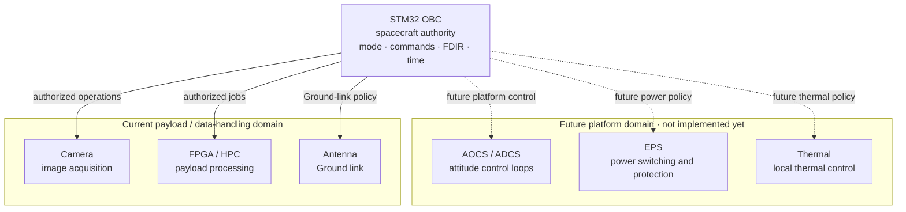
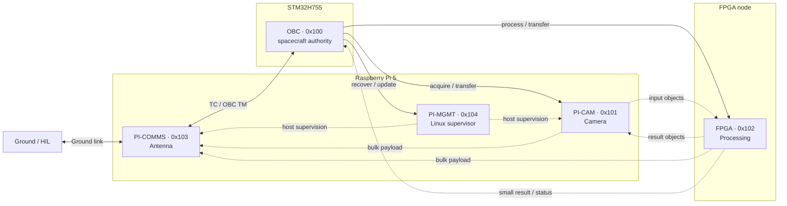
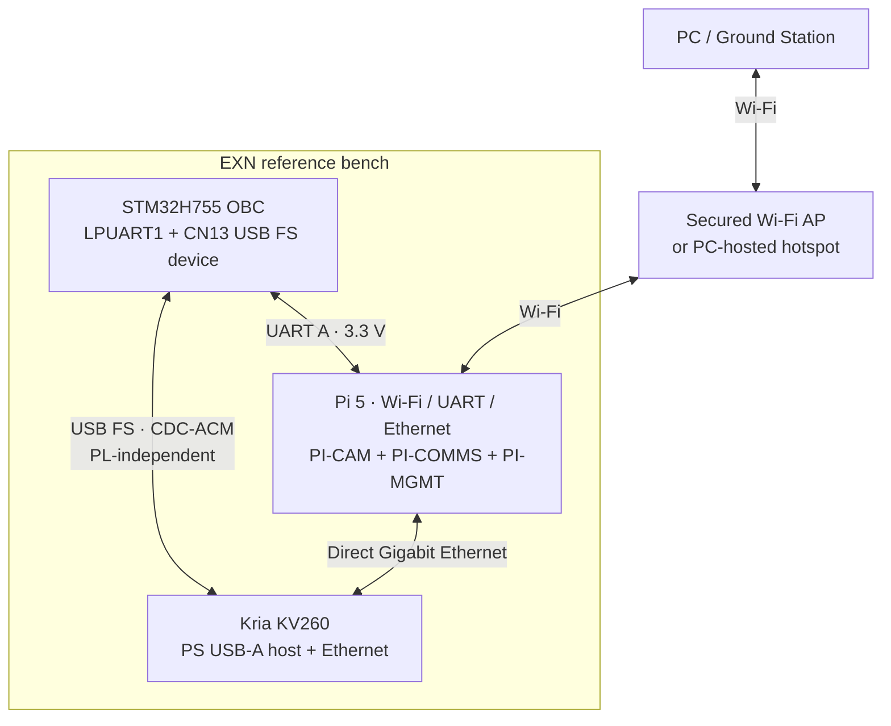
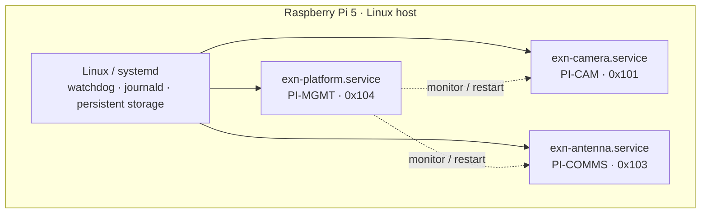
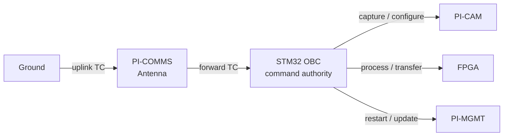
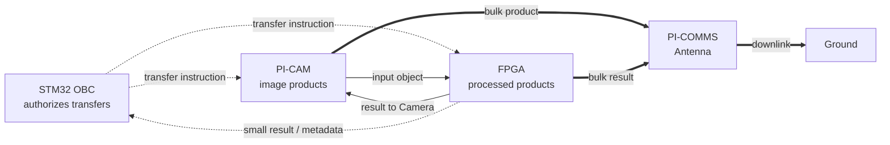
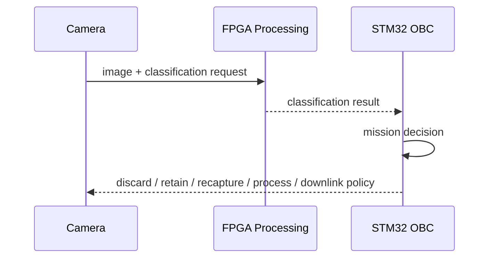
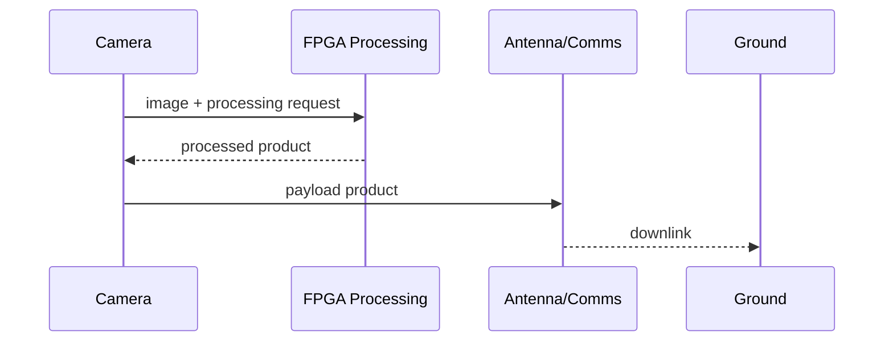
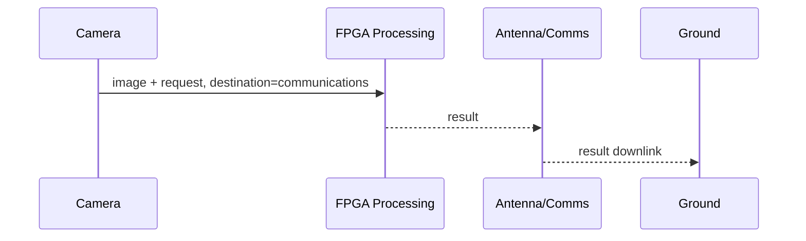
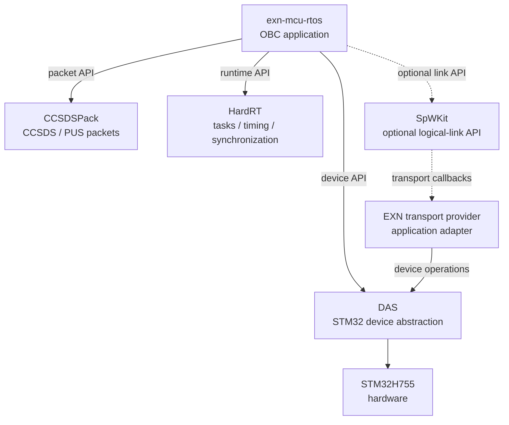

# EXN System Architecture

This document defines the logical EXN system architecture and the ownership boundaries between the control computer, Linux payload services, FPGA processing, ground communications, and reusable platform libraries.

The master wire-level contract remains [`docs/ICD.md`](ICD.md), [`docs/services.md`](services.md) defines the mission PUS service tailoring, and [`docs/component-services.md`](component-services.md) defines the complete endpoint behavior. This document describes how EXN components are intended to be composed and how control/data may flow between them without forcing one fixed mission pipeline. Representative time-ordered interactions live in [sequence diagrams](diagrams.md), while the detailed PUS-by-endpoint view is the [service deployment map](services.md#6-service-deployment-map).

## 1. Architectural principles

EXN is a modular avionics and payload demonstrator. The architecture intentionally separates **logical spacecraft endpoints** from the **physical computers** that currently host them.

The main rules are:

1. **STM32/OBC is the spacecraft platform authority.** It owns spacecraft mode, mission sequencing, command authorization/dispatch, time authority, spacecraft-wide supervision and FDIR. Platform and payload subsystems may execute local control/processing, but they remain subordinate to OBC authority.
2. **The Raspberry Pi 5 is a dual-role Embedded Linux payload node.** In the initial EXN deployment it performs both the Camera role and the Antenna role. Those roles are separate logical endpoints/services even though they share one physical computer.
3. **The FPGA is a processing node.** Its EXN role is image preprocessing, inference, postprocessing, and other hardware-accelerated payload computation.
4. **Processing results do not have one fixed destination.** The requester or mission policy selects where a result is delivered.
5. **Bulk payload data need not transit the MCU.** Control traffic should remain MCU-centric, while high-volume data paths may connect payload endpoints directly.
6. **Transport is below mission semantics.** Packet/service behavior must not depend on whether the current carrier is Ethernet, a simulated SpaceWire link, local Linux IPC, or a future physical transport.
7. **Reusable libraries remain independent projects.** EXN consumes CCSDSPack, HardRT, DAS, and optionally SpWKit. Their internal implementation scope is not part of the EXN mission architecture.
8. **PUS services are explicitly tailored.** CCSDSPack supplies the packet/header mechanisms; EXN defines which standard PUS services it realizes and which mission-specific services it adds. Service identifiers shall not be repurposed with unrelated semantics.

## 1.1 Centralized authority, distributed execution

EXN distinguishes **authority** from **execution location**.

The OBC does not need to execute every algorithm itself. A future AOCS controller may run attitude estimation and high-rate wheel/torquer loops; an EPS controller may perform power switching/protection; a thermal controller may run heater loops; an HPC may perform image/AI processing. Those are distributed execution resources.

The OBC remains responsible for:

- spacecraft mode and safe-state ownership;
- mission/platform sequencing;
- telecommand authorization and dispatch;
- subsystem enable/disable and high-level set-points;
- health aggregation and FDIR;
- on-board time authority and distribution;
- platform-wide recovery decisions;
- deciding when payload products/processors may influence spacecraft actions.

A subsystem may autonomously protect itself locally, but it shall not independently redefine spacecraft mission state or safety policy.

The current EXN stage focuses on the payload/data-handling subset: Camera, Antenna, FPGA processing and Pi management. AOCS/ADCS, EPS, thermal and other platform subsystems are future scope and therefore intentionally lack detailed service ICDs today.



**Dashed connections** indicate planned platform subsystems, not deployed hardware. Even when a subordinate controller closes its own fast loop or performs independent local protection, spacecraft mission/safety authority remains with the OBC.

## 2. Logical system

The [README](../README.md#logical-system) introduces the primary endpoints. This more detailed view distinguishes **command authority and supervision (solid links)** from **payload/data handoffs and platform supervision (dashed links)**.



These are **permitted logical paths**, not a separate physical wire for each edge and not a mandatory fixed mission-processing pipeline.

## 3. Physical deployment

The selected **reference bench interconnect** is deliberately **switchless**:

- PC/GS to PI-COMMS over a secured Wi-Fi AP or PC hotspot;
- STM32 OBC to Pi 5 through an independent 3.3 V UART;
- STM32 OBC to Kria KV260 through the **STM32 CN13 USB Full-Speed CDC-ACM device**, with a KV260 **USB-A host** connected directly by USB-A-to-Micro-B data cable;
- Pi 5 to KV260 directly by a single Gigabit Ethernet cable for image transfers.



**No Ethernet switch, OBC TCP/IP stack or separate network adapter is required.** The Pi needs an independently supervised `exn-linkd` UART packet router so a PI-COMMS crash does not also block OBC access to PI-MGMT. The KV260 USB host uses the processing system and standard Linux CDC-ACM support, requiring no PL UART. The STM32 USB device firmware still needs implementing.

The Pi UART and KV260 USB CDC serial streams use COBS with `0x00` delimiter around complete PUS-C CCSDS packets; Pi↔KV260 Ethernet and Wi-Fi carry complete CCSDS packets over TCP. The two-host wired IP subnet is `10.77.0.0/30`; there is no Wi-Fi-to-Ethernet IP routing/NAT.

The [inter-device link ICD](icd/inter-node-links.md) defines the Pi UART pins, Nucleo CN13 power precautions, KV260 USB host/device roles, packet framing, deployment addresses and failure behavior. USB control remains dependent on the KV260 PS/Linux host; an independent hardware reset/power-control path is not provided.

Camera and Antenna remain **two first-class mission responsibilities of the same Raspberry Pi 5**, independently addressable through PI-CAM and PI-COMMS. PI-MGMT is their supporting platform-supervision endpoint. Physical host placement may change without changing their logical responsibility.

## 4. Raspberry Pi dual-role payload node

The Raspberry Pi shall be treated as one physical spacecraft payload computer with two mission-facing functions rather than as one camera executable with optional extras:

1. **PI-CAM** acquires and owns payload imagery/products.
2. **PI-COMMS is the Antenna service.** It owns the Ground-facing link, exchanges TCs/TMs with the OBC, and transmits payload products from Camera or FPGA to Ground.

Linux platform management supervises both functions but is not itself a third primary mission role. It is exposed as supporting endpoint **PI-MGMT (`0x104`)** so the OBC can restart/update Camera or Antenna even when the target mission process is not responsive.

A representative host-service layout is:



PI-MGMT interfaces with Linux supervision facilities; it does not replace `systemd` or become the sole watchdog itself.

### 4.1 Camera service

Responsibilities include:

- sensor acquisition;
- image metadata and product ownership;
- capture configuration;
- local buffering/storage;
- compression or host-side preparation;
- transfer to FPGA for processing;
- reception/association of processed products;
- direct handoff to the Antenna service when appropriate.

The Camera service remains the natural owner of captured payload products even when computation is delegated to FPGA.

### 4.2 Antenna service

Responsibilities include:

- own the Ground-facing RF/Wi-Fi/network link;
- receive Ground TCs and forward them to the OBC;
- receive OBC TMs and forward them to Ground;
- accept payload data directly from PI-CAM or FPGA and downlink it to Ground when commanded/policy permits;
- report link/session health and status.

The Antenna service is **not** the spacecraft command authority. The OBC remains the authority. Ground TCs pass `Ground -> Antenna -> OBC`; OBC TMs pass `OBC -> Antenna -> Ground`. For bulk data, the OBC may command PI-CAM or FPGA to send an object to the Antenna service, which then transmits it to Ground. This bypasses the OBC as a bulk-data router while preserving OBC control.

### 4.3 Platform management / PI-MGMT

The Linux platform-management layer should provide or aggregate:

- hardware/system watchdog integration;
- service restart/supervision state;
- CPU load and temperature;
- memory and storage state;
- process/service health;
- network/link state;
- restart/error counters;
- uptime and system-level events.

`systemd` may provide process supervision and watchdog integration. PI-MGMT turns those host capabilities into an OBC-addressable management endpoint for service restart, Pi reboot, platform HK/alarms and software activation.

## 5. Control plane and data plane

EXN deliberately distinguishes the control plane from the bulk data plane.

### 5.1 Control plane

The OBC authorizes downstream operations even when the executor runs on a different processor or operating system.



The HIL deployment may connect the Ground tooling directly to a physical OBC or simulator. This changes transport topology, not command authority.

### 5.2 Data plane

Payload bytes may bypass the MCU as a **bulk-data router**, while the OBC still controls what may be transferred.



**Thick arrows** represent bulk payload delivery, **thin solid arrows** represent product handoffs, and **dashed arrows** represent control/metadata. The OBC owns the transfer decision, but it does not have to relay image bytes. Antenna remains the Ground-link endpoint.

## 6. FPGA processing and result routing

The FPGA is a **processing service**, not a fixed stage in a hard-coded `Camera -> FPGA -> Camera` pipeline.

A processing request conceptually contains:

```text
job identifier
processing/pipeline identifier
input reference or input stream
processing parameters
result destination(s)
delivery policy
```

The exact wire encoding of the routing fields is intentionally left to the Service 210/interface revision that implements this architecture. The architectural requirement is already fixed: **result routing must be controllable per processing request or by an explicitly configured mission policy.**

### 6.1 Typical destinations

A processing result may be routed to one or more of:

- **OBC**, for autonomous decisions, event generation, or subsequent commanding;
- **Camera service**, to associate the result with the source image, store it, or generate another payload product;
- **Antenna service**, which performs the actual Ground downlink;
- **requesting endpoint**, for request/response-style processing;
- **multiple endpoints**, when both control and payload consumers need the result.

### 6.2 Example: autonomous classification



A classification can therefore influence spacecraft behavior without requiring a full processed image to return through the MCU.

### 6.3 Example: processed payload product



### 6.4 Example: direct result downlink



Direct downlink is conditional on Antenna link availability and mission policy. The FPGA routes the result to the Antenna service; it does not own a Ground link itself. Loss of the Ground link must not make FPGA execution semantics depend on the ground station being present.

## 7. SpWKit in EXN

SpWKit may be used as a logical SpaceWire-style interconnect and simulation layer between EXN endpoints.

A useful deployment can expose Camera–OBC, Antenna–OBC, Camera–FPGA, Camera–Antenna and FPGA–Antenna logical links over one real Ethernet carrier. See the [shared-Ethernet logical-link diagram](diagrams.md#7-logical-links-over-shared-ethernet).

This lets EXN model multiple spacecraft communication relationships without requiring one physical cable per logical link.

SpWKit remains a reusable independent project. EXN should consume only the public transport/link behavior that it needs. **Commercial/private FPGA SpaceWire implementation repositories are outside EXN scope.** The EXN FPGA node is defined by its payload-processing role, not by any separate SpaceWire FPGA product.

On STM32, any future SpWKit-over-Ethernet binding should preserve the application-owned transport-provider boundary. That layering is shown in the software-composition diagram below.

SpWKit must not require DAS directly, and DAS must not know about SpWKit. HardRT provides scheduling, synchronization, timing, IRQ-to-task signalling, and timeout/retry execution around the application and transport integration.

## 8. PUS service architecture

EXN treats the PUS service catalogue as an application-interface layer above CCSDS packet construction and below endpoint mission logic.

The normative EXN wire profile is **PUS Revision C** as defined in [`ICD.md`](ICD.md) and [`services.md`](services.md). Any remaining PUS-A code in component repositories is migration debt and shall be replaced rather than extended.

The active service split is:

- standard Services **1, 3, 5, 8, 9, 12 and 20** for request verification, HK, events, function management, time, monitoring and runtime parameters;
- mission-specific Services **200, 210, 220 and 230** for Camera, processing, payload-object transfer and software management;
- standard Service **23** reserved for its PUS File Management meaning, not repurposed for image transfer.

The [service deployment map](services.md#6-service-deployment-map) contains the complete endpoint-by-service view.

This distinction is architectural, not cosmetic. A transport implementation such as SpWKit carries complete packet bytes and does not redefine PUS services; likewise, FPGA image-processing logic does not acquire communications-service ownership merely because it can physically emit results.

The central PUS-C service profile is the normative baseline for current and future endpoint implementations.

## 9. Reusable software composition

Reusable libraries are **peer dependencies consumed by an EXN application**, not one vertical framework that owns every layer below it. The diagram shows an STM32 integration with an **optional** SpWKit transport provider implemented by the application.



Dashed edges are optional integration relationships. SpWKit and HardRT do not directly depend on DAS. This diagram explains application composition; it is not a claim about the libraries' internal linker dependencies.

## 10. Interface ownership

The documentation boundary is:

- **`docs/architecture.md`**: logical nodes, responsibilities, control/data paths, routing policy, and reusable-stack composition;
- **`docs/component-services.md`**: complete endpoint functions, management, heartbeat, time, acquisition, processing, transfer and update behavior;
- **`docs/services.md`**: PUS service tailoring, standard/mission-specific allocation, and migration policy;
- **`docs/ICD.md`**: exact CCSDS/PUS wire contract and routing fields;
- **`docs/icd/`**: endpoint-specific service behavior and payload layouts;
- **component repositories**: implementation details;
- **CCSDSPack / HardRT / DAS / SpWKit repositories**: reusable library APIs and implementation-specific qualification.

This separation allows EXN to change deployment topology without rewriting mission semantics and allows reusable libraries to evolve without becoming EXN-specific.