# EXN — Sequence Diagrams

This page collects representative EXN interactions among Ground Station (GS), STM32/OBC, Linux payload services, and FPGA processing.

The diagrams show **valid flows**, not one mandatory pipeline. EXN separates control authority from payload-data routing, and FPGA processing results may be routed differently depending on the request and mission policy.

> [!NOTE]
> All packet identifiers in these diagrams use the normative **PUS Revision C** EXN service profile. One-shot endpoint HK uses TC[3,27] / TM[3,25]; EXN System HK uses TC[3,128] / TM[3,129].

---

## 1) System Housekeeping Snapshot

The OBC supervises endpoints continuously and maintains the authoritative spacecraft HK cache. A Ground System-HK request does not normally create a downstream TC fan-out; it asks the OBC to serialize its current snapshot.

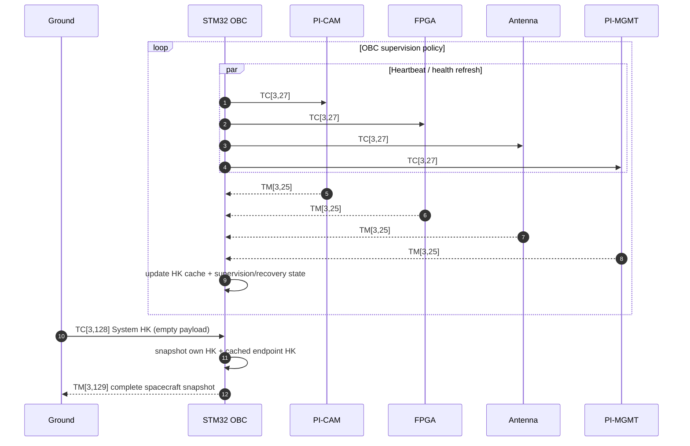

An endpoint that does not respond remains represented in the snapshot as STALE/OFFLINE/ERROR, together with its last valid cached data and OBC recovery state.

---

## 2) Flight-like Ground Command Path

Ground traffic enters through the Pi Antenna service, while the OBC remains the command authority. The same Antenna service carries OBC telemetry back to Ground.

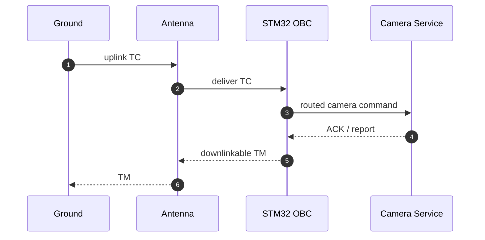

---

## 3) Capture -> FPGA Processing -> Camera Product -> Ground

The Camera service owns the payload product and delegates computation to FPGA.

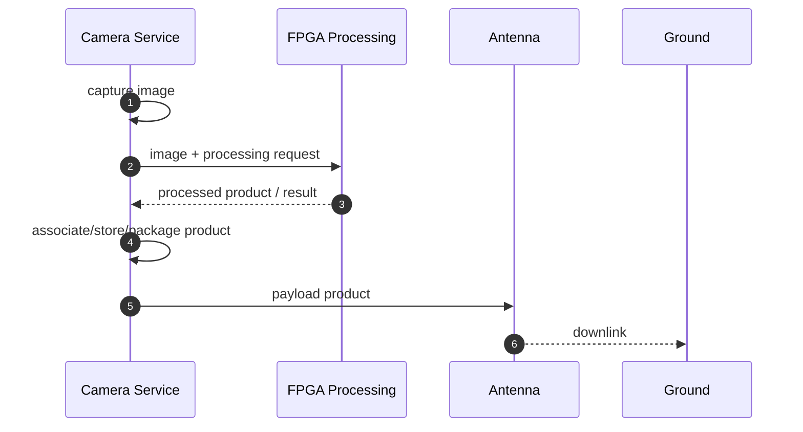

---

## 4) Classification Result Routed to OBC

A low-volume inference result may be sent directly to the OBC so software can make an autonomous mission decision.

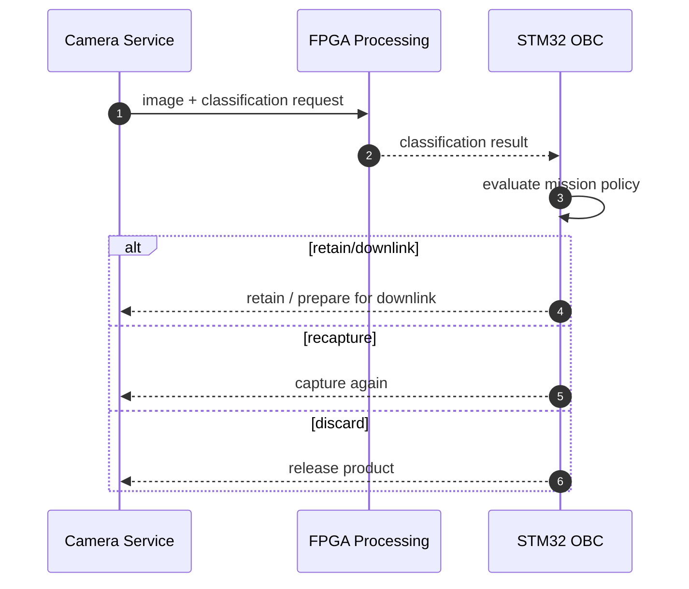

---

## 5) OBC-Controlled Direct FPGA Result Downlink

When a ground link exists and policy permits it, a processing result may bypass the OBC data path.

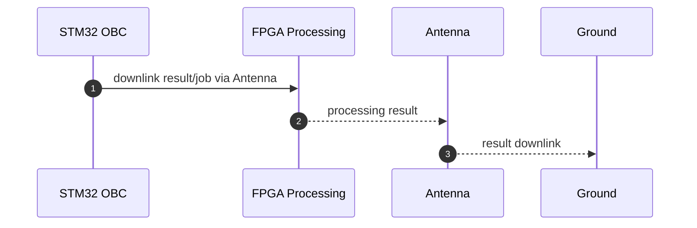

The OBC may still receive separate status, metadata, or decision-relevant information. `Direct` here means FPGA -> Antenna -> Ground without routing the bulk result through the OBC; it does not bypass the Antenna link.

---

## 6) OBC-Controlled Direct Camera Downlink

The OBC controls the operation, but the image bytes do not transit the MCU.

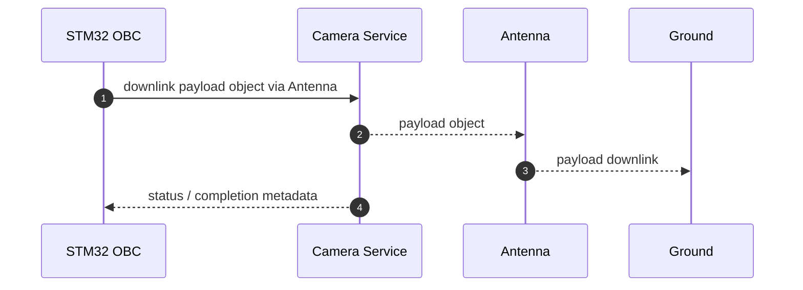

---

## 7) Logical Links over Shared Ethernet

SpWKit may represent multiple logical relationships over one physical Ethernet carrier.

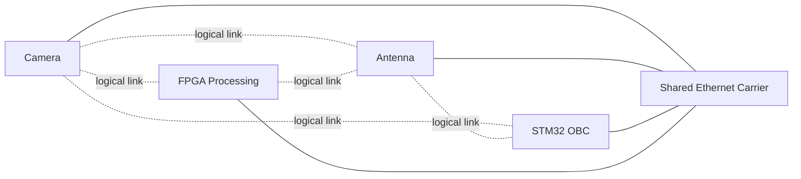

The logical routes are independent of whether Camera and Antenna currently execute on the same Raspberry Pi.

---

## 8) Heartbeat / Health Supervision

The OBC supervises every endpoint independently.

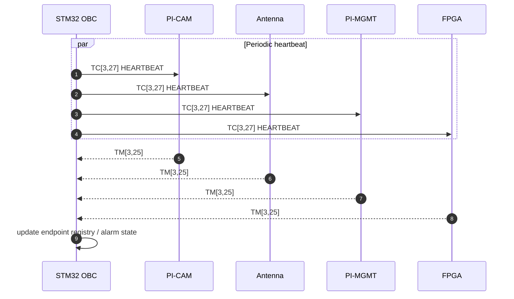

Missing heartbeat intervals transition an endpoint through STALE/OFFLINE according to OBC Service 20 policy and produce Service 5 events. If automatic recovery is enabled and the configured recovery delay expires, the OBC records and attempts the configured recovery action; System HK exposes that state.

---

## 9) Restart Failed Camera Service

PI-MGMT performs process recovery so a failed Camera process is not required to receive its own restart command.

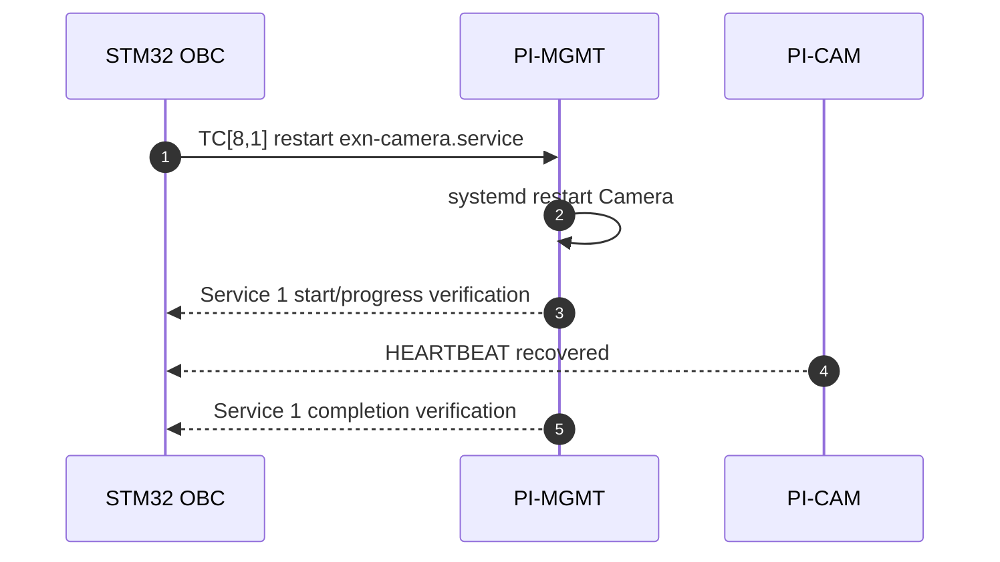

The same pattern applies to the Antenna service.

---

## 10) OBC Time Synchronization

The OBC owns the synchronized mission clock and distributes it to every endpoint.

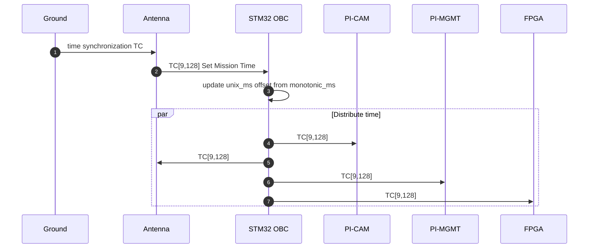

Endpoint timers remain monotonic; synchronized Unix-epoch time is used for mission timestamps.

---

## 11) Camera Acquisition and Multi-Format Products

One acquisition may preserve RAW and create multiple derived products.

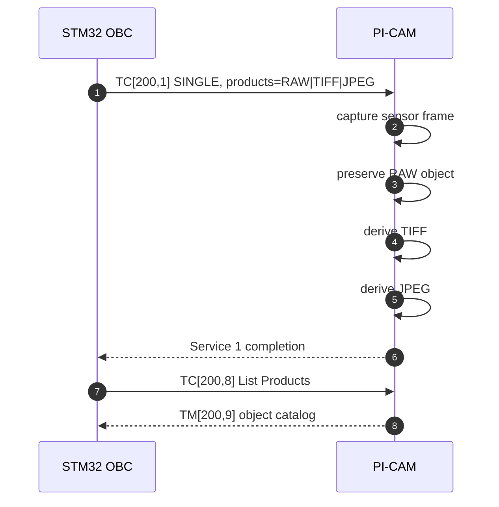

The OBC may then select any product for processing, local retention or Ground downlink.

---

## 12) Software Update of Pi Camera Service

Update payload transfer and software activation are separate operations.

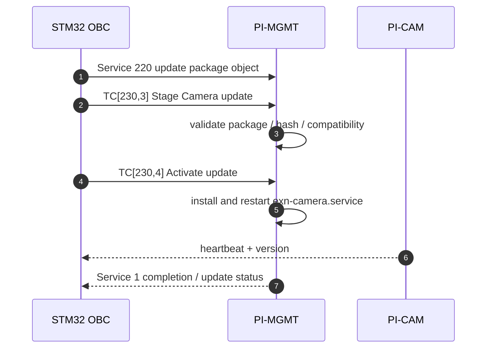

An update is not successful until the updated component returns healthy.
