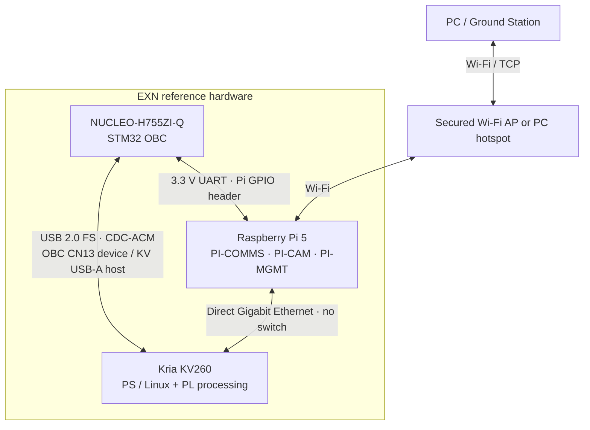
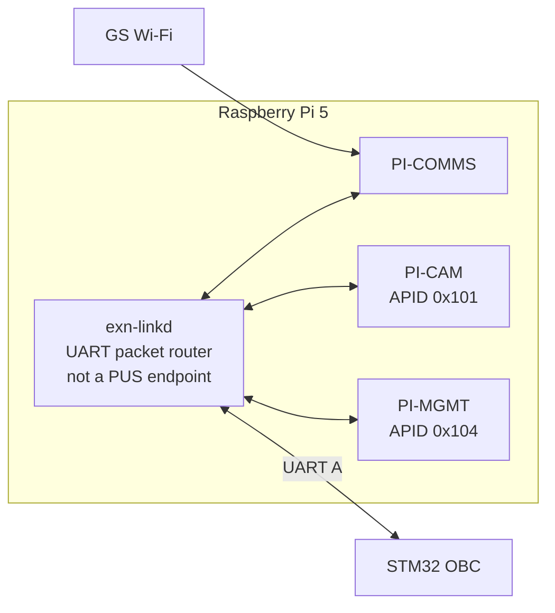

# EXN Reference Inter-Device Link ICD

**Status:** normative reference *laboratory integration transport profile* for the selected STM32H755 Nucleo OBC, Raspberry Pi 5, AMD Kria KV260, and PC/GS. **No switch is required.** This describes required software and cables, not verified working hardware.

See [system architecture](../architecture.md), [master PUS-C packet ICD](../ICD.md), [Ground ICD](gs.md), [OBC ICD](mcu-rtos.md), [Pi ICD](linux-payload.md), [FPGA ICD](fpga-ai.md), and the matching [machine-readable reference profile](../../interfaces/network/reference-topology.json).

## 1. Physical connection baseline



| Link | Physical interface | Role | Status |
|---|---|---|---|
| PC/GS ↔ Pi | Wi-Fi, via secured AP/hotspot | Ground PUS TCs, spacecraft TM and payload downloads | selected lab assumption |
| OBC ↔ Pi | 3.3 V UART, crossed TX/RX and common GND | Ground command gateway and Pi HK/management | to be wired/implemented |
| OBC ↔ KV260 | **KV260 USB-A host ↔ STM32 CN13 Micro-AB USB FS device** | FPGA job commands, HK, time, recovery verification, through USB CDC-ACM | selected, not yet implemented or validated |
| Pi ↔ KV260 | Direct Gigabit Ethernet cable | image inputs, processed products and bulk downlink | to be configured/validated |
| PI-CAM ↔ PI-COMMS ↔ PI-MGMT | Pi Linux local IPC | same-host service dispatch and object handoff | to be implemented |

The OBC↔KV260 control path uses the KV260 **processing system (PS) USB host**, not programmable logic (PL). No FPGA UART/PL IP, Pmod pinout or custom board modification is required for this link. Both the KV260's **J4 micro-USB FTDI UART/JTAG debug connection** and its **J2 Pmod** remain free for development.

The Nucleo CN13 Micro-AB connector is the target STM32 USB FS OTG/device interface, **not the ST-LINK debugger USB connector**. Use a normal USB-A-to-Micro-B data cable from one KV260 Type-A USB host port to Nucleo CN13, with the STM32 separately powered as required by ST UM2408. Observe the manufacturer's explicit caution to power the Nucleo board **before** connecting CN13 to avoid potential I/O current injection. Validate the actual board power/jumper configuration before plugging in.

Neither OBC nor a network switch carries Pi↔KV260 bulk traffic. The STM32 Ethernet PHY is **not used** in this reference profile. The wired Pi↔KV260 connection needs only a normal Cat5e/Cat6 cable and two static IP addresses.

## 2. Control-link electrical and USB profiles

### 2.1 OBC ↔ Pi UART

Reference connector allocation, subject to bench pinout verification:

- STM32H755: `LPUART1` on `PB6 TX`, `PB7 RX` via board expansion connectors.
- Pi 5: UART0 remapped to GPIO14 TX (40-pin header pin 8), GPIO15 RX (pin 10), plus a header GND.
- Cross TX/RX and connect GND. Both are 3.3 V logic; do not connect 5 V UART.
- Explicitly enable the Pi's header UART and ensure no console/login shell uses it. Pi 5's normal primary debug UART may use its separate debug header rather than GPIO14/15.

| UART attribute | Baseline |
|---|---|
| Mode | 8N1, full duplex |
| Initial bit rate | 115200 baud; 921600 baud is an optional later qualification target |
| Flow control | none initially; bounded queues |
| Packet framing | COBS over a complete CCSDS Space Packet, terminated by `0x00` |

This is short, direct TTL wiring for laboratory integration, not flight-qualified interconnect.

### 2.2 OBC ↔ KV260 USB CDC-ACM

The KV260's **existing PS-connected USB Type-A host ports** (U44/U46) connect directly to the STM32's **CN13 USB OTG Full-Speed Micro-AB device port**.

- **KV260**: USB host, Linux USB core and `cdc_acm` driver; serial-like interface such as `/dev/ttyACM0` after successful enumeration. Use `/dev/serial/by-id/` or a dedicated udev rule rather than assuming a permanent tty number.
- **STM32 OBC**: USB device, CDC-ACM class over the dedicated target USB FS peripheral; implement bounded USB RX/TX queues, device enumeration/re-enumeration and disconnect handling.
- **Physical cable**: standard USB-A-to-Micro-B **data** cable. Neither USB cable cutting nor direct D+/D− wiring to UART pins is permitted.
- **Power**: KV260 host provides USB VBUS for enumeration. Nucleo must be separately powered according to UM2408; CN13 must not be treated as Nucleo's power source. Verify jumpers/USB VBUS-sensing setup.
- **Packet framing**: same bounded `COBS(CCSDS packet) + 0x00` framing as the Pi UART. USB CDC-ACM exposes a byte stream, not application packet boundaries.
- **Rate**: USB **Full-Speed up to 12 Mbit/s theoretical bus signaling**, not the KV260 host port's 5 Gbit/s rating. This is for control and HK, never bulk image transfers.

USB enumeration is initiated by the KV260 **host**. Once enumerated, communication is bidirectional: the STM32 can issue TCs and receive TM, but the KV260/Linux USB host must be operational for the control session to exist. This control channel is **independent of FPGA PL configuration and reconfiguration**, not independent of the KV260 PS, Linux USB host or operating system.

The KV260's J4 micro-USB is **not** the chosen EXN control interface: it connects to an onboard FTDI UART/JTAG bridge, is normally used for development, and would require the STM32 to implement USB host mode with a suitable FTDI vendor-specific driver. The STM32's ST-LINK port likewise does not substitute for the target USB device connector CN13.

## 3. Transport framing

All links carry the same complete **CCSDS Space Packet + PUS Revision C + EXN CRC16**. The carrier determines how packet boundaries are found.

| Link | Transport / packet framing |
|---|---|
| GS ↔ PI-COMMS Wi-Fi | IPv4 TCP byte stream, consecutive CCSDS Space Packets, length from primary header |
| Pi ↔ KV260 Ethernet | IPv4 TCP byte stream, same CCSDS primary-header-based framing |
| OBC ↔ Pi UART | COBS(complete CCSDS Space Packet) + `0x00` frame delimiter |
| OBC ↔ KV260 USB CDC-ACM | COBS(complete CCSDS Space Packet) + `0x00` frame delimiter |

On TCP: decoded CCSDS packet length is `6 + (packet_data_length + 1)`. Receivers must tolerate split/coalesced reads.

On UART and CDC-ACM: encode **all bytes** of one CCSDS packet (primary header, PUS secondary header, application data, CRC16) using COBS, then append `0x00`. Buffer until delimiter, decode within a strict bound, validate CCSDS declared length and CRC16, then dispatch the packet. On malformed/oversized frames, discard through the next delimiter and record an error. USB CDC reads and writes are stream operations and can split frames arbitrarily.

The **initial maximum decoded CCSDS Space Packet** on both control links is **8192 bytes**, subject to actual fixed-memory OBC receive-budget verification. Serial and USB COBS buffers must include encoding overhead and delimiter. System HK shall not silently omit endpoints to fit this bound; measure the real worst case before claiming integration readiness.

Service 220 image/object chunks on the direct Ethernet data path initially carry up to **1024 payload-object bytes** per packet. Neither UART nor USB CDC is the bulk image path.

Re-enumeration or reconnection does not prove endpoint liveness or command completion. Service 1 verification and normal OBC HEARTBEAT/HK supervision remain authoritative. Endpoint reports and packet retransmission must not result in silent duplicate execution of state-changing TCs.

## 4. Pi serial router and mission endpoints

The Pi has **one physical UART control link** and **three logical endpoints**: PI-CAM (`0x101`), PI-COMMS (`0x103`) and PI-MGMT (`0x104`).

A lightweight, bounded **Pi packet-router transport daemon** (working name `exn-linkd`) terminates UART A and dispatches CCSDS packets locally by **destination APID for TCs**. Its local IPC clients are the three Pi services, which remain logically independent.



The serial router must be **independently supervised by Linux/systemd**, not owned by the PI-COMMS process. A failed Antenna service must not remove OBC's ability to request PI-MGMT HK/restart operations across an otherwise functional Pi UART link. The router is **not** a fourth spacecraft endpoint and has no APID or PUS identity.

PI-COMMS terminates the Wi-Fi Ground TCP session and sends Ground TCs through `exn-linkd` to the OBC; it does not independently authorize Camera/FPGA actions. Responses and selected OBC TM return through the Pi router to PI-COMMS. Direct FPGA object downlink arrives through Pi Ethernet and is forwarded by PI-COMMS to Ground.

TC APID identifies the logical **destination** endpoint; TM APID identifies the **producer**. On-board Ethernet IP addresses and local process/socket addresses do not determine PUS identity. The OBC remains spacecraft authority even though Linux owns the GPIO UART device on its end.

## 5. Direct Pi ↔ KV260 Ethernet configuration

This is a **two-host private link**, not a routed LAN:

| Device | Reference physical IP | Netmask |
|---|---|---|
| Pi 5 wired `eth0` | `10.77.0.1` | `/30` |
| KV260 wired NIC | `10.77.0.2` | `/30` |

No switch, default gateway, DHCP, NAT, bridge or IP forwarding is required on the wired link. Pi `wlan0` uses the separate Wi-Fi AP's configuration (usually DHCP). If the Wi-Fi network collides with `10.77.0.0/30`, reassign the wired lab subnet in the deployment configuration.

Reference data listeners:

| Endpoint | Transport listener | Consumer |
|---|---|---|
| KV260 FPGA | `10.77.0.2:47102` TCP | receive PI-CAM image objects / send job-result objects |
| PI-CAM | `10.77.0.1:47101` TCP or same-host IPC | receive FPGA output products |
| PI-COMMS | `10.77.0.1:47103` TCP or same-host IPC | receive FPGA result objects destined for Ground |
| Pi management | local IPC; **no Ethernet listener required** | recovery/software management from OBC UART |

Those ports are **deployment allocations**, not APID numbers. The initial data path transports Service 220 PUS-C packets end to end with the same TCP framing as EXN-GS. An Ethernet listener is not proof that the corresponding processing/transfer implementation exists.

## 6. Ground Wi-Fi interface

The PC/GS connects to the Raspberry Pi's PI-COMMS Wi-Fi listener at:

```text
tcp://<PI_WIFI_IP>:47000
```

This remains compatible with the existing EXN-GS daemon `tcp://HOST:PORT` device-link syntax. The Pi gateway/listener is still to be built.

Only **one authenticated-by-environment laboratory Ground command session** is permitted initially; arbitrary TCP clients must not control the spacecraft. Wi-Fi should use WPA2/WPA3 security and a trusted isolated AP/hotspot. **TCP, CRC16 and Wi-Fi link security alone do not provide spacecraft command authentication, replay protection or access-control policy**. Do not expose this lab interface to an untrusted network.

PI-COMMS is an **application-level packet gateway**, not an IP router. No direct Wi-Fi/PC access to the OBC, KV260 processing application or private Ethernet data listener is authorized.

The shared PI-COMMS Ground stream carries OBC verification/HK/events as well as Camera/FPGA authorized payload/downlink TM. PI-COMMS must serialize complete packet writes, use bounded buffers and prioritize **Service 1 verification and Service 5 alarms** ahead of bulk Service 220 chunks, without corrupting/interleaving bytes inside a packet.

## 7. Endpoint direction and authority

| Path | Traffic | Command/data authority |
|---|---|---|
| GS → Pi Wi-Fi → UART A → OBC | Ground TC to OBC APID `0x100` | Pi packet router relays; OBC authenticates/authorizes as specified by mission policy |
| OBC → UART A → PI-CAM/PI-MGMT/PI-COMMS | endpoint TC including S3 HK, S8 recovery, S200 Camera, S230 updates | OBC issues new PUS-C TC, Source ID `0x0001` |
| OBC → UART B → KV260 | S3 HK, S210 jobs, time, service verification | OBC TC Source ID `0x0001`; FPGA responds over same UART |
| PI-CAM → Ethernet → FPGA | image / input objects via S220 | authorized object transfer under OBC policy |
| FPGA → Ethernet → PI-CAM | processed product object via S220 | destination defined by processing job |
| FPGA → Ethernet → PI-COMMS → Wi-Fi → GS | payload result object via S220 | OBC decides transfer; no OBC byte relay |
| OBC → UART A → PI-COMMS → Wi-Fi → GS | System HK, events, spacecraft reporting | OBC-generated TM, forwarded without APID rewrite |

The UART links are **bidirectional**. Unsolicited endpoint events or reports can return over the same physical serial line. When UART B is down, the Pi↔FPGA Ethernet link may still function; **OBC does not infer that FPGA is healthy merely because Pi can reach its IP address**.

## 8. Failure handling and recovery

- **Wi-Fi loss** affects only PI-COMMS Ground-link availability and queued downlink. OBC↔Pi/FPGA UART supervision continues.
- **PI-COMMS service crash:** Pi transport router and PI-MGMT remain independently operational, letting OBC request a service restart. Their independence is software/process-level, not physical redundancy.
- **Pi power/OS failure:** loss of Pi UART A affects PI-CAM, PI-COMMS and PI-MGMT as a common-mode fault; recovery cannot rely on PI-MGMT if the entire Pi has failed.
- **FPGA control UART failure:** OBC marks FPGA `STALE/OFFLINE` per configured policy even if its Ethernet port remains up.
- **PL not configured/reconfigured:** Pmod serial control may be unavailable. A permanently available control link independent of PL would require a different verified physical interface.
- **Automatic hard recovery:** a failed serial link cannot deliver `SOFT_REBOOT` to an unresponsive endpoint. Independent reset/power controls are **not included in this wiring profile**; without one, the OBC reports recovery `SUPPRESSED`, journals the fault and informs Ground in System HK.
- **UART noise/resets:** malformed COBS or CRC failures must not produce TC execution. Bound buffers, report error counters, and resynchronize on `0x00`.
- **Wi-Fi throughput competition:** bulk Service 220 transfers must not starve OBC fault/event reporting. Backpressure is reflected in transfer state; a queued TCP write is not necessarily end-to-end delivery.

## 9. Commissioning and validation

1. Confirm Nucleo LPUART1/USART2 connector routing and Pi GPIO pinmux/debug-console ownership; verify all UART signal levels are 3.3 V before wiring.
2. Confirm the KV260 carrier revision and Pmod pins and create a **minimal, stable PL UART** accessible to KV260 processing software. Show explicit boot/reconfiguration and failure behavior.
3. Connect Pi↔KV260 with one Ethernet cable, configure only the `10.77.0.0/30` link, and test ping and TCP packet round-trip at negotiated Gigabit rate.
4. Send bounded COBS-framed PUS-C packets with CRC over each UART independently. Test disconnect, malformed frames, oversized frames and reconnect.
5. Validate PI `exn-linkd` routes PI-CAM/PI-COMMS/PI-MGMT APIDs independently, including after PI-COMMS crash.
6. Send GS TC through Pi Wi-Fi, Pi packet router and UART A into OBC. Verify Service 1 responses and OBC→Ground TM.
7. Send FPGA TC and collect HK over UART B while simultaneously moving an image Pi↔KV260 through direct Ethernet, without OBC payload relay.
8. Collect System HK with correctly reported link ages and per-endpoint recovery states; verify OBC stays alive after loss of Ground Wi-Fi.
9. Test Pi OS failure and FPGA PL reconfiguration as explicit common-mode/fault cases; recovery without hard reset shall report `SUPPRESSED`.
10. Measure packet sizes, UART throughput, bounded STM32 memory and maximum System HK/report delivery time. Verify control/critical-TM priority under Ethernet/Wi-Fi bulk load.

**Implementation status:** this is a specified reference transport, **not** an already-wired/validated system. Drivers, Pi link routing, FPGA control UART design, Service 220 transfers, priority queues and end-to-end tests remain implementation tasks.

## 10. Future interface upgrades

UART control is a convenient **laboratory** substitute for spacecraft internal communication buses. A future version can replace it with CAN-FD (requires board-side physical transceivers and a matching FPGA controller), SpaceWire (requires a physical implementation), or another qualified redundant interface without changing PUS-C service IDs or OBC authority.

SpWKit is available for later SpaceWire/virtual-link integration, but this reference **does not require SpWKit** and should not claim that its UDP backend somehow operates over GPIO UART without a new backend.

## Hardware references

- [ST UM2408 STM32H7 Nucleo-144 board manual](https://www.st.com/resource/en/user_manual/dm00499171.pdf): extension connectors and UART pin multiplexing.
- [Raspberry Pi configuration/UART documentation](https://www.raspberrypi.com/documentation/computers/configuration.html): Pi 5 header UART versus dedicated debug UART and 3.3 V signal level.
- [AMD UG1089 KV260 connector guide](https://docs.amd.com/r/en-US/ug1089-kv260-starter-kit/Interfaces): J2 Pmod, J4 USB/FTDI console, J10 Gigabit Ethernet.
- [AMD UG1089 KV260 Pmod power budget](https://docs.amd.com/r/en-US/ug1089-kv260-starter-kit/Powering-the-Starter-Kit-and-Power-Budgets): 3.3 V Pmod supply.
