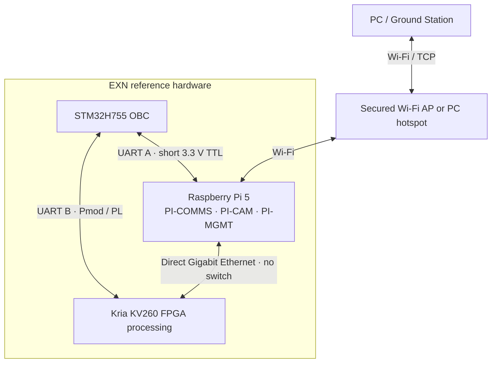
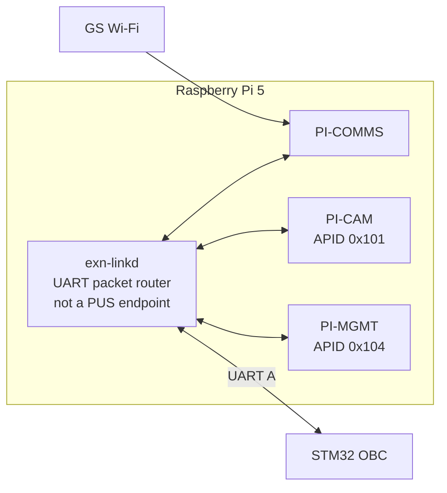

# EXN Reference Inter-Device Link ICD

**Status:** normative reference *laboratory integration transport profile* for the selected STM32H755 Nucleo OBC, Raspberry Pi 5, AMD Kria KV260, and PC/GS. **No switch is required.** This describes required software and cables, not verified working hardware.

See [system architecture](../architecture.md), [master PUS-C packet ICD](../ICD.md), [Ground ICD](gs.md), [OBC ICD](mcu-rtos.md), [Pi ICD](linux-payload.md), [FPGA ICD](fpga-ai.md), and the matching [machine-readable reference profile](../../interfaces/network/reference-topology.json).

## 1. Physical connection baseline



| Link | Physical interface | Role | Status |
|---|---|---|---|
| PC/GS ↔ Pi | Wi-Fi, via secured AP/hotspot | Ground PUS TCs, spacecraft TM, payload downloads | selected lab assumption |
| OBC ↔ Pi | independent 3.3 V UART, crossed TX/RX and common GND | spacecraft command gateway, Pi endpoint HK/management | to be wired/implemented |
| OBC ↔ KV260 | independent 3.3 V UART, OBC USART ↔ KV260 **J2 Pmod PL I/O** | FPGA job commands, HK, time, recovery/verification | **requires FPGA control-UART logic and host integration** |
| Pi ↔ KV260 | **direct** RJ45 Gigabit Ethernet cable | input images, processed objects, bulk data to PI-COMMS | to be configured/validated |
| PI-CAM ↔ PI-COMMS ↔ PI-MGMT | Pi Linux local IPC | Pi endpoint dispatch and same-host object handoff | to be implemented |

Neither the STM32 nor any other device is part of the Pi↔KV260 bulk-data path. **The STM32 Ethernet PHY is not used in this reference profile.** No Ethernet switch, adapter dongle, CAN transceiver, external level shifter or other active network module is needed for the selected physical topology; the FPGA's Pmod serial controller is software/RTL work.

A conventional Cat5e/Cat6 cable can directly join Pi 5 and KV260 Gigabit Ethernet ports; modern Ethernet PHYs normally support auto-MDI/MDIX. Both board ports and final cable/link negotiation must still be tested. Wi-Fi and wired Ethernet remain separate physical networks.

## 2. Control-link UART electrical profile

### 2.1 OBC ↔ Pi UART A

Reference connector allocation, subject to a **bench pinout check before wiring**:

- STM32H755: `LPUART1` on `PB6 TX`, `PB7 RX` (board Zio/morpho access).
- Pi 5: `UART0` on GPIO14 TX (40-pin header physical **8**), GPIO15 RX (physical **10**), and header GND.
- Cross `OBC TX → Pi RX` and `Pi TX → OBC RX`; connect GND.
- Enable the Pi's **header** UART using the appropriate Linux pinmux/device-tree configuration. Do **not** assume that Pi 5 `/dev/serial0` points to GPIO14/15: its default primary/debug UART is on the separate debug header.
- Reserve the selected UART for EXN; disable any serial login shell or boot console using those same GPIOs.

### 2.2 OBC ↔ KV260 UART B

Reference control link:

- STM32H755: independent `USART2` on `PD5 TX` / `PD6 RX` via the board's expansion connectors, after verifying their actual connector positions and alternate-function routing.
- KV260: carrier **J2 Digilent Pmod**. Assign two suitable 3.3 V PL I/O pins to UART RX/TX in the platform constraints, cross the wires, and connect GND.
- **Do not connect the KV260 FTDI/J4 USB debug UART directly to STM32 GPIO.** It is a USB device/debug interface, not a 3.3 V TTL header.
- The Pmod UART requires a programmed FPGA configuration and a bridge to the processing software (e.g., a minimal PL UART peripheral and a Linux driver/character device). The exact Pmod pin mapping, RTL, device-tree and startup dependency will be frozen in a board-specific implementation note after checking the KV260 carrier revision and Vivado constraints.
- The serial control interface must remain available through normal accelerator-job changes whenever practical; losing the PL configuration causes OBC to mark the FPGA control endpoint unavailable.

### 2.3 Electrical and UART operating rules

Both links are **point-to-point**, independent of one another, short 3.3 V push-pull TTL serial connections. They are for the bench, **not flight-grade wiring**. Verify common reference grounds and connector voltages with hardware documentation before connecting; never connect 5 V UART levels or directly join unrelated power rails. Avoid long loose wires and powered/unpowered I/O backfeeding.

Initial settings on each link:

| Attribute | Baseline |
|---|---|
| UART mode | full duplex, 8 data, no parity, 1 stop (8N1) |
| Initial baud | **115200**, then qualify **921600** as a configurable higher-rate mode |
| Hardware flow control | none initially; bounded sender queues required |
| Link identity | UART A = PI logical endpoint router; UART B = FPGA |
| Electrical interface | 3.3 V logic; crossed TX/RX + GND |
| Framing | COBS with `0x00` frame delimiter; details below |

Distinct UART peripheral assignments prevent one unresponsive subordinate from blocking the other transport. OBC prioritization/scheduling must not share a blocking driver critical section between the two links.

## 3. Transport framing

The **same complete CCSDS Space Packet with PUS-C and its CRC16** is exchanged across all links. Transport encapsulation is different:

| Link | Transport encoding |
|---|---|
| GS ↔ PI-COMMS Wi-Fi | TCP IPv4 **byte stream of concatenated CCSDS Space Packets**; decode CCSDS 6-byte primary header to find packet extent |
| PI ↔ KV260 Ethernet | TCP IPv4 **byte stream of concatenated CCSDS Space Packets**; same GS framing |
| OBC ↔ Pi / OBC ↔ KV260 UART | **COBS(complete CCSDS Space Packet) + `0x00` delimiter** per frame |

For TCP, CCSDS packet total bytes = `6 + (packet_data_length + 1)`. No extra TCP length prefix. A receiver must handle partial/coalesced TCP reads.

For serial, the transmitter encodes **all bytes of one complete CCSDS packet**, including primary header, PUS-C fields, application data and CRC16, into one COBS frame. It appends a single `0x00` delimiter. The receiver:

1. buffers until a `0x00` delimiter with a configured bound;
2. decodes COBS into a complete Space Packet;
3. checks decoded size against the CCSDS primary-header length and per-link maximum;
4. validates packet CRC16 and PUS-C/mission structure before dispatch;
5. drops malformed/oversized frames and resynchronizes at the next delimiter without forwarding partial payloads.

COBS is **UART framing only**, not a new spacecraft protocol header or a substitute for packet CRC. Idle gaps/timeouts, serial overruns and buffer exhaustion are reported as transport errors. A partially received frame never causes TC execution.

Initial maximum decoded CCSDS Space Packet length: **8192 bytes** (requires fixed-size bounded RX memory on the STM32). UART TX/RX COBS buffers must also allow encoding overhead and delimiter. This cap and the resulting System-HK maximum must be validated; **System HK must not silently truncate endpoints**. Service 220 image/object chunks on the direct Ethernet data path initially use up to **1024 application-object bytes** per packet. High-volume image transfer is not routed over either UART.

Link-level reconnect or COBS resynchronization is **not** evidence that a command has completed. Service 1 verification remains authoritative; duplicate/replayed state-changing TCs need explicit handling at the application layer.

## 4. Pi serial router and mission endpoints

The Pi has **one physical UART control link** and **three logical endpoints**: PI-CAM (`0x101`), PI-COMMS (`0x103`) and PI-MGMT (`0x104`).

A lightweight, bounded **Pi packet-router transport daemon** (working name `exn-linkd`) terminates UART A and dispatches CCSDS packets locally by **destination APID for TCs**. Its local IPC clients are the three Pi services, which remain logically independent.



The serial router must be **independently supervised by Linux/systemd**, not owned by the PI-COMMS process. A failed Antenna service must not remove OBC's ability to request PI-MGMT HK/restart operations across an otherwise functional Pi UART link. The router is **not** a fourth spacecraft endpoint and has no APID or PUS identity.

PI-COMMS terminates the Wi-Fi Ground TCP session and sends Ground TCs through `exn-linkd` to the OBC; it does not independently authorize Camera/FPGA actions. Responses and selected OBC TM return through the Pi router to PI-COMMS. Direct FPGA object downlink arrives through Pi Ethernet and is forwarded by PI-COMMS to Ground.

TC APID identifies the logical **destination** endpoint; TM APID identifies the **producer**. On-board Ethernet IP addresses and local process/socket addresses do not determine PUS identity. The OBC remains spacecraft authority even though Linux owns the GPIO UART device on its end.

## 5. Direct Pi ↔ KV260 Ethernet configuration

This is a **two-host private link**, not a routed LAN:

| Device | Reference physical IP | Netmask |
|---|---|---|
| Pi 5 wired `eth0` | `10.77.0.1` | `/30` |
| KV260 wired NIC | `10.77.0.2` | `/30` |

No switch, default gateway, DHCP, NAT, bridge or IP forwarding is required on the wired link. Pi `wlan0` uses the separate Wi-Fi AP's configuration (usually DHCP). If the Wi-Fi network collides with `10.77.0.0/30`, reassign the wired lab subnet in the deployment configuration.

Reference data listeners:

| Endpoint | Transport listener | Consumer |
|---|---|---|
| KV260 FPGA | `10.77.0.2:47102` TCP | receive PI-CAM image objects / send job-result objects |
| PI-CAM | `10.77.0.1:47101` TCP or same-host IPC | receive FPGA output products |
| PI-COMMS | `10.77.0.1:47103` TCP or same-host IPC | receive FPGA result objects destined for Ground |
| Pi management | local IPC; **no Ethernet listener required** | recovery/software management from OBC UART |

Those ports are **deployment allocations**, not APID numbers. The initial data path transports Service 220 PUS-C packets end to end with the same TCP framing as EXN-GS. An Ethernet listener is not proof that the corresponding processing/transfer implementation exists.

## 6. Ground Wi-Fi interface

The PC/GS connects to the Raspberry Pi's PI-COMMS Wi-Fi listener at:

```text
tcp://<PI_WIFI_IP>:47000
```

This remains compatible with the existing EXN-GS daemon `tcp://HOST:PORT` device-link syntax. The Pi gateway/listener is still to be built.

Only **one authenticated-by-environment laboratory Ground command session** is permitted initially; arbitrary TCP clients must not control the spacecraft. Wi-Fi should use WPA2/WPA3 security and a trusted isolated AP/hotspot. **TCP, CRC16 and Wi-Fi link security alone do not provide spacecraft command authentication, replay protection or access-control policy**. Do not expose this lab interface to an untrusted network.

PI-COMMS is an **application-level packet gateway**, not an IP router. No direct Wi-Fi/PC access to the OBC, KV260 processing application or private Ethernet data listener is authorized.

The shared PI-COMMS Ground stream carries OBC verification/HK/events as well as Camera/FPGA authorized payload/downlink TM. PI-COMMS must serialize complete packet writes, use bounded buffers and prioritize **Service 1 verification and Service 5 alarms** ahead of bulk Service 220 chunks, without corrupting/interleaving bytes inside a packet.

## 7. Endpoint direction and authority

| Path | Traffic | Command/data authority |
|---|---|---|
| GS → Pi Wi-Fi → UART A → OBC | Ground TC to OBC APID `0x100` | Pi packet router relays; OBC authenticates/authorizes as specified by mission policy |
| OBC → UART A → PI-CAM/PI-MGMT/PI-COMMS | endpoint TC including S3 HK, S8 recovery, S200 Camera, S230 updates | OBC issues new PUS-C TC, Source ID `0x0001` |
| OBC → UART B → KV260 | S3 HK, S210 jobs, time, service verification | OBC TC Source ID `0x0001`; FPGA responds over same UART |
| PI-CAM → Ethernet → FPGA | image / input objects via S220 | authorized object transfer under OBC policy |
| FPGA → Ethernet → PI-CAM | processed product object via S220 | destination defined by processing job |
| FPGA → Ethernet → PI-COMMS → Wi-Fi → GS | payload result object via S220 | OBC decides transfer; no OBC byte relay |
| OBC → UART A → PI-COMMS → Wi-Fi → GS | System HK, events, spacecraft reporting | OBC-generated TM, forwarded without APID rewrite |

The UART links are **bidirectional**. Unsolicited endpoint events or reports can return over the same physical serial line. When UART B is down, the Pi↔FPGA Ethernet link may still function; **OBC does not infer that FPGA is healthy merely because Pi can reach its IP address**.

## 8. Failure handling and recovery

- **Wi-Fi loss** affects only PI-COMMS Ground-link availability and queued downlink. OBC↔Pi/FPGA UART supervision continues.
- **PI-COMMS service crash:** Pi transport router and PI-MGMT remain independently operational, letting OBC request a service restart. Their independence is software/process-level, not physical redundancy.
- **Pi power/OS failure:** loss of Pi UART A affects PI-CAM, PI-COMMS and PI-MGMT as a common-mode fault; recovery cannot rely on PI-MGMT if the entire Pi has failed.
- **FPGA control UART failure:** OBC marks FPGA `STALE/OFFLINE` per configured policy even if its Ethernet port remains up.
- **PL not configured/reconfigured:** Pmod serial control may be unavailable. A permanently available control link independent of PL would require a different verified physical interface.
- **Automatic hard recovery:** a failed serial link cannot deliver `SOFT_REBOOT` to an unresponsive endpoint. Independent reset/power controls are **not included in this wiring profile**; without one, the OBC reports recovery `SUPPRESSED`, journals the fault and informs Ground in System HK.
- **UART noise/resets:** malformed COBS or CRC failures must not produce TC execution. Bound buffers, report error counters, and resynchronize on `0x00`.
- **Wi-Fi throughput competition:** bulk Service 220 transfers must not starve OBC fault/event reporting. Backpressure is reflected in transfer state; a queued TCP write is not necessarily end-to-end delivery.

## 9. Commissioning and validation

1. Confirm Nucleo LPUART1/USART2 connector routing and Pi GPIO pinmux/debug-console ownership; verify all UART signal levels are 3.3 V before wiring.
2. Confirm the KV260 carrier revision and Pmod pins and create a **minimal, stable PL UART** accessible to KV260 processing software. Show explicit boot/reconfiguration and failure behavior.
3. Connect Pi↔KV260 with one Ethernet cable, configure only the `10.77.0.0/30` link, and test ping and TCP packet round-trip at negotiated Gigabit rate.
4. Send bounded COBS-framed PUS-C packets with CRC over each UART independently. Test disconnect, malformed frames, oversized frames and reconnect.
5. Validate PI `exn-linkd` routes PI-CAM/PI-COMMS/PI-MGMT APIDs independently, including after PI-COMMS crash.
6. Send GS TC through Pi Wi-Fi, Pi packet router and UART A into OBC. Verify Service 1 responses and OBC→Ground TM.
7. Send FPGA TC and collect HK over UART B while simultaneously moving an image Pi↔KV260 through direct Ethernet, without OBC payload relay.
8. Collect System HK with correctly reported link ages and per-endpoint recovery states; verify OBC stays alive after loss of Ground Wi-Fi.
9. Test Pi OS failure and FPGA PL reconfiguration as explicit common-mode/fault cases; recovery without hard reset shall report `SUPPRESSED`.
10. Measure packet sizes, UART throughput, bounded STM32 memory and maximum System HK/report delivery time. Verify control/critical-TM priority under Ethernet/Wi-Fi bulk load.

**Implementation status:** this is a specified reference transport, **not** an already-wired/validated system. Drivers, Pi link routing, FPGA control UART design, Service 220 transfers, priority queues and end-to-end tests remain implementation tasks.

## 10. Future interface upgrades

UART control is a convenient **laboratory** substitute for spacecraft internal communication buses. A future version can replace it with CAN-FD (requires board-side physical transceivers and a matching FPGA controller), SpaceWire (requires a physical implementation), or another qualified redundant interface without changing PUS-C service IDs or OBC authority.

SpWKit is available for later SpaceWire/virtual-link integration, but this reference **does not require SpWKit** and should not claim that its UDP backend somehow operates over GPIO UART without a new backend.

## Hardware references

- [ST UM2408 STM32H7 Nucleo-144 board manual](https://www.st.com/resource/en/user_manual/dm00499171.pdf): extension connectors and UART pin multiplexing.
- [Raspberry Pi configuration/UART documentation](https://www.raspberrypi.com/documentation/computers/configuration.html): Pi 5 header UART versus dedicated debug UART and 3.3 V signal level.
- [AMD UG1089 KV260 connector guide](https://docs.amd.com/r/en-US/ug1089-kv260-starter-kit/Interfaces): J2 Pmod, J4 USB/FTDI console, J10 Gigabit Ethernet.
- [AMD UG1089 KV260 Pmod power budget](https://docs.amd.com/r/en-US/ug1089-kv260-starter-kit/Powering-the-Starter-Kit-and-Power-Budgets): 3.3 V Pmod supply.
