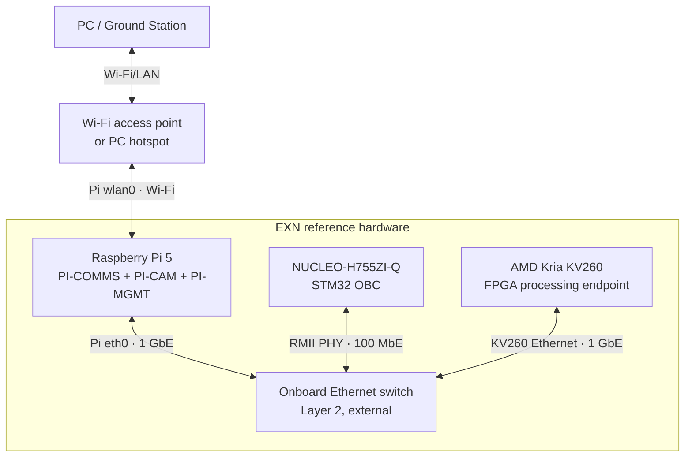
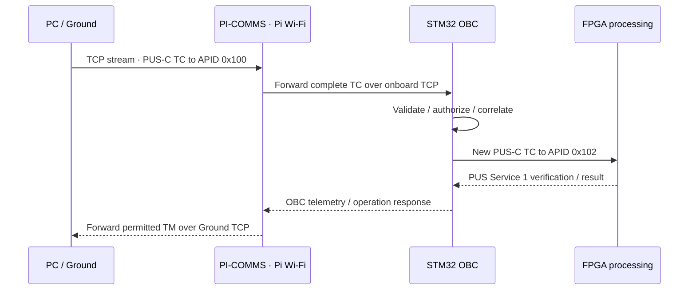

# EXN Reference Inter-Device Link ICD

**Status:** normative reference *integration transport profile* for the current STM32H755, Raspberry Pi 5, AMD Kria KV260 and PC/GS demonstrator. This document specifies how the already-defined logical endpoints communicate on the reference hardware. It does **not** redefine CCSDS/PUS message payloads or claim flight-qualified networking.

Related contracts:

- [System architecture](../architecture.md): spacecraft authority, logical nodes, control/data planes.
- [Master packet ICD](../ICD.md): PUS-C identity, CCSDS packet framing, CRC, routing envelope.
- [Ground ICD](gs.md), [OBC ICD](mcu-rtos.md), [Pi ICD](linux-payload.md), [FPGA ICD](fpga-ai.md): endpoint behavior.
- [Service catalogue](../services.md) and [interaction sequences](../diagrams.md).
- Machine-readable reference deployment: [`../../interfaces/network/reference-topology.json`](../../interfaces/network/reference-topology.json).

## 1. Reference physical topology



| Interface | Equipment | Reference use | Physical/link capacity |
|---|---|---|---|
| Ground link | PC/GS ↔ Pi `wlan0` | command and telemetry uplink/downlink, payload download | Wi-Fi; negotiated by AP and clients |
| OBC onboard | NUCLEO-H755ZI-Q RJ45 ↔ Ethernet switch | OBC TC/TM and supervision | 10/100 Ethernet, LAN8742A PHY |
| Pi onboard | Pi 5 RJ45 ↔ Ethernet switch | Pi services, Camera objects, Ground gateway | Gigabit Ethernet |
| FPGA onboard | KV260 RJ45 ↔ Ethernet switch | Service 210 control and Service 220 objects | Gigabit Ethernet |
| Pi local | PI-CAM ↔ PI-COMMS ↔ PI-MGMT on same Linux host | cross-process management and product handoff | local IPC or loopback |

The switch is a **required external integration component** for this three-host wired topology. It is not assumed to have already been purchased, connected or validated. No additional Ethernet port, Ethernet-over-USB adapter, or special FPGA carrier PHY is assumed.

The PC and Pi may use an existing secured Wi-Fi AP or a PC-hosted hotspot. This is a laboratory Ground-link **emulation**, not an RF subsystem or a claim about in-orbit Wi-Fi support.

## 2. Network separation and addressing

Two network domains are intentionally separate.

| Domain | Reference network | Configuration | Role |
|---|---|---|---|
| Onboard wired LAN | `10.77.0.0/24` | static IPv4, no default gateway or DHCP required | device↔device control and data |
| Ground Wi-Fi LAN | assigned by the chosen AP | Pi `wlan0` and PC normally obtain DHCP leases | Ground↔PI-COMMS only |

The `10.77.0.0/24` subnet is a **proposed EXN lab allocation** within RFC 1918 private space. It shall be changed in the deployment profile if it overlaps the selected Wi-Fi LAN or an existing network.

| Hardware | Physical interface | Reference onboard IPv4 |
|---|---|---|
| STM32 OBC | Ethernet PHY / RJ45 | `10.77.0.10/24` |
| Raspberry Pi 5 | `eth0` | `10.77.0.20/24` |
| Kria KV260 | wired Ethernet (`eth0` when named so by Linux) | `10.77.0.30/24` |

There is **no general IP route, NAT or bridge** between Wi-Fi and the onboard LAN. PI-COMMS is an **application-level CCSDS packet gateway**. GS/PC has no direct IP access to OBC or FPGA through the Pi in normal operations.

IP addresses and TCP ports are properties of this reference deployment, **not spacecraft APIDs or PUS source IDs**. Alternative physical networks may change them while preserving the mission ICD.

## 3. Reference transport and packet framing

**Selected initial reference transport:** IPv4/TCP for both the Wi-Fi Ground link and the wired onboard host-to-host links.

This deliberately reuses the existing EXN-GS `tcp://HOST:PORT` device-link support. The STM32 application still needs a verified Ethernet/TCP implementation (for example a bounded, statically provisioned TCP/IP stack); no implemented OBC network stack is assumed here.

Each TCP stream contains **concatenated complete CCSDS Space Packets**. There is no custom packet wrapper and no additional TCP length prefix:

1. Read the first **6 bytes** of the CCSDS primary header.
2. Decode the CCSDS 16-bit Packet Data Length field (`L`).
3. Total packet length is **`6 + L + 1` bytes**.
4. Read exactly that many bytes before decoding the packet, including the normal EXN CRC16.
5. Repeat for the next packet. TCP reads/writes may split or coalesce packet boundaries.

This is framing, **not** authorization or integrity authentication. PUS-C remains the common mission protocol and Service 1 remains the request-verification mechanism.

**Initial integration packet budget:** receivers shall support complete packets of up to **8192 bytes** per CCSDS Space Packet. Each endpoint shall use bounded memory and reject packets beyond its configured and tested receive capacity. Service 220 object chunks should initially carry at most **1024 payload bytes** per TM to leave room for PUS headers/object metadata and avoid large transient buffers.

The System-HK `TM[3,129]` must be verified against this bound using all registered endpoints and their maximum configured cache structures. It shall **not silently discard endpoints or fields** to fit the packet. If the current representation cannot fit, the ICD/transfer strategy requires a coordinated amendment and a conformance test before that expanded profile is claimed supported.

No application-layer packet sequence, acknowledgment, or segmentation header is introduced here. TCP carries complete Space Packets and supplies byte-stream transport; PUS performs operation verification and Service 220 defines object-transfer state. Reconnection alone does not mean a TC has completed or an object has been transferred.

## 4. Logical endpoints, addresses and listeners

The reference profile uses one **TCP service port per logical endpoint**, regardless of whether several endpoints share a Pi. These are EXN example integration allocations, not standardized internet service ports.

| EXN endpoint | APID | PUS-C ID | Listener in onboard LAN | Primary host |
|---|---|---|---|---|
| STM32 OBC | `0x100` | `0x0001` | `10.77.0.10:47100` | STM32 |
| PI-CAM | `0x101` | `0x0002` | `10.77.0.20:47101` | Pi 5 |
| FPGA processing | `0x102` | `0x0003` | `10.77.0.30:47102` | KV260 |
| PI-COMMS/Antenna | `0x103` | `0x0004` | `10.77.0.20:47103` | Pi 5 |
| PI-MGMT | `0x104` | `0x0005` | `10.77.0.20:47104` | Pi 5 |
| Ground Station | `0x0F0` | `0x0010` | **no onboard LAN listener** | PC |

**Separate Ground-facing PI-COMMS listener:** TCP **port `47000` bound to the Pi Wi-Fi interface**. GS connects using the Wi-Fi address of that Pi, for example:

```sh
exn_gsd --port tcp://<PI_WIFI_IP>:47000
```

The above is the existing GS daemon link URI syntax; Pi's listener at this port is **to be implemented**.

The Pi-COMMS Ground listener must **not** bind indiscriminately to the onboard-LAN interface. Onboard listeners must similarly be restricted to the wired interface and, where useful for Pi co-hosted services, explicit local loopback addresses. Host firewall rules shall reinforce the separation.

No APID-to-IP address guessing is permitted. A configured **endpoint registry** maps the destination APID to the reachable physical-host listener; a TCP port is never interpreted as an alternative mission identity.

## 5. Inter-device interfaces and routing

| Link | Who initiates | What travels | Destination/authority |
|---|---|---|---|
| GS ↔ PI-COMMS over Wi-Fi | GS/daemon connects to Pi | PUS-C Ground TCs; authorized TMs, events, System HK and payload downlink | Pi forwards Ground TCs to OBC, not directly to Camera/FPGA |
| PI-COMMS ↔ OBC over Ethernet | OBC opens/maintains bidirectional supervisory session to Antenna listener; traffic flows both ways | Ground-origin TCs forwarded unchanged to OBC; OBC TM; Antenna HK/management TC/TM | OBC authorizes commands; antenna forwards |
| OBC ↔ PI-CAM | OBC opens supervisory TCP session to Camera listener | Service 1/3/5/9/12/20, S200 and transfer instructions | OBC commands; Camera reports |
| OBC ↔ FPGA | OBC opens supervisory TCP session to FPGA listener | Service 1/3/5/9/12/20, S210 jobs, S220 instructions | OBC commands; FPGA reports |
| OBC ↔ PI-MGMT | OBC opens supervisory TCP session to management listener | Service 8, S230, Pi platform HK/sensors, time | OBC supervises host recovery |
| PI-CAM ↔ FPGA | producing/receiving application opens object-delivery connection as required | Service 220 input images and returned products | OBC-controlled destinations |
| FPGA ↔ PI-COMMS | FPGA opens object-delivery connection as required | Service 220 downlink packets | OBC authorizes transfer; Antenna forwards to GS |
| PI-CAM ↔ PI-COMMS | same-host local IPC / loopback | Service 220 product handoff or object reference | PI-COMMS owns Ground-facing traffic |

The primary OBC↔endpoint supervisory sessions are **bidirectional**: replies and events can travel back over an established connection without a new connection per HK request. A device requiring a separate direct object transfer uses the target endpoint's configured listener.

An OBC-issued TC is a **new packet** with the target APID and OBC Source ID `0x0001`. A Ground-origin TC directed to OBC retains Ground Source ID `0x0010` while Antenna forwards it. The Antenna shall not reassign either packet's APID or PUS identifiers merely because it carried the bytes.

A source-to-Antenna Service 220 downlink is forwarded with the **original producer APID** and Ground PUS destination `0x0010` where applicable. This avoids sending FPGA imagery through the STM32's 100-Mbit path.

PI-CAM, PI-COMMS and PI-MGMT remain independent logical endpoints on one Linux host. Internal object references or Unix-domain sockets may optimize their implementation, but the logical Service 220/management contracts remain unchanged.

## 6. Ground ingress and security boundary



A **single active Ground command session** is the initial baseline. PI-COMMS shall serialize packet writes to the Ground TCP stream. A second client shall not independently inject Ground telecommands until a multi-client command-authority policy is specified.

The Wi-Fi network must use an appropriately secured local AP/hotspot (WPA2/WPA3 as available); no credentials belong in the repository. TCP and the CCSDS CRC16 **do not provide authentication or encryption**. This is a laboratory deployment only, not a security-approved flight or untrusted-internet command interface. Ground authorization, authentication and replay protection require a separate reviewed security profile before exposure to untrusted networks.

## 7. Availability, failure and recovery behavior

- Onboard link failures and TCP disconnects affect the corresponding OBC **supervision state**. OBC uses Service 20 heartbeat/health/offline/recovery policy, not a TCP socket's `connected` flag, to decide that a device is operational.
- TCP reconnect may restore transport before the endpoint's post-recovery HEARTBEAT/HEALTH proves readiness. Endpoint software uptime/reset count and OBC recovery flags remain independent.
- **Ground Wi-Fi loss** changes PI-COMMS Ground-link availability and is reported in its LINKS/HEALTH telemetry. OBC, Pi and FPGA continue their internal supervision and operations according to stored mission policy. Unsent Ground TMs are not automatically declared delivered.
- **Pi failure** can simultaneously remove PI-CAM, PI-COMMS and PI-MGMT even though they have distinct APIDs. Their fault containment is logical, not physical; OBC shall reflect loss of all affected endpoints.
- **Ethernet switch failure** is a common-mode onboard-link failure; it must not be misdiagnosed as independent crashes in all subordinate nodes.
- **FPGA unreachable**: software reboot through the failed TCP connection is not an independent recovery path. Hard reset/power cycling requires explicitly wired/verified reset or EPS control hardware; otherwise recovery is SUPPRESSED.
- **Application-level operation state** (Service 1, Service 210 jobs, Service 220 objects, Service 230 update activation) is independent of TCP connection state. TCP retransmission/reconnect must not result in silent duplicate state-changing TC execution.

## 8. Configuration and integration evidence

The reference allocation is mirrored in [`interfaces/network/reference-topology.json`](../../interfaces/network/reference-topology.json). Physical addresses, ports, Wi-Fi SSID, credentials, interface names and enabled link providers are **deployment configuration**, not mission-visible Service 20 parameters. OBC-controlled policies *about* link enable/disable, HK cadence and recovery remain Service 20 or Service 8.

Initial interface-qualification tests:

1. Confirm STM32 Ethernet PHY and board jumpers, Pi `eth0/wlan0`, KV260 Gigabit Ethernet and external switch connectivity.
2. Establish wired TCP connectivity for OBC↔PI-CAM, OBC↔PI-COMMS, OBC↔PI-MGMT and OBC↔FPGA, with correct endpoint dispatch.
3. Establish Wi-Fi GS `tcp://PI_WIFI_IP:47000`, send valid PUS-C TC through Antenna to OBC, and verify Service 1/response correlation.
4. Collect `TC[3,128]` / `TM[3,129]` spacecraft HK, including nonresponsive endpoint states.
5. Transfer an image PI-CAM→FPGA and a result FPGA→Antenna→GS using Service 220 **without routing bulk bytes through OBC**.
6. Drop GS Wi-Fi only: onboard HK stays operational; PI-COMMS detects loss.
7. Drop one onboard Ethernet/TCP session: OBC reports STALE/OFFLINE and only acts on the configured verified recovery path.
8. Restart Pi/FPGA: verify TCP reconnection, endpoint uptime/reset counters and OBC recovery journal continuity.
9. Verify maximum supported System-HK packet length, bounded memory and Service 220 chunking under low-memory MCU conditions.
10. Validate no unauthorized Wi-Fi↔wired IP forwarding, and verify packets destined to an unregistered APID are rejected.

**Release condition:** this document is an interface *definition*, not a claim that the physical links, STM32 TCP stack, PI-COMMS Wi-Fi gateway or FPGA Service 220 endpoint have been implemented or tested.

## 9. Future transport substitution

The **PUS-C mission interface is transport-independent**. Future SpaceWire/SpaceFibre, SpWKit-backed virtual links, serial HIL or alternate wired links may replace a TCP carrier by an explicit deployment profile without reallocating APIDs, service numbers, payload fields or subsystem authority.

SpWKit `v0.7.0` has a stable VSPW-TP/UDP hosted backend and an integration boundary for device/driver backends; this is **not** evidence of a plug-and-play raw-Ethernet or STM32 TCP backend. Adoption needs a separate interoperability test and binding definition.

## Hardware references

- ST UM2408 NUCLEO-H755ZI-Q Ethernet (LAN8742A, 10/100 RMII): https://www.st.com/resource/en/user_manual/um2408-stm32h7-nucleo144-boards-mb1363-stmicroelectronics.pdf
- Raspberry Pi 5 product brief (Wi-Fi and Gigabit Ethernet): https://pip-assets.raspberrypi.com/categories/892-raspberry-pi-5/documents/RP-008348-DS-4-raspberry-pi-5-product-brief.pdf
- AMD KV260 DS986 (one 10/100/1000 Ethernet port): https://docs.amd.com/r/en-US/ds986-kv260-starter-kit/Product-Details
