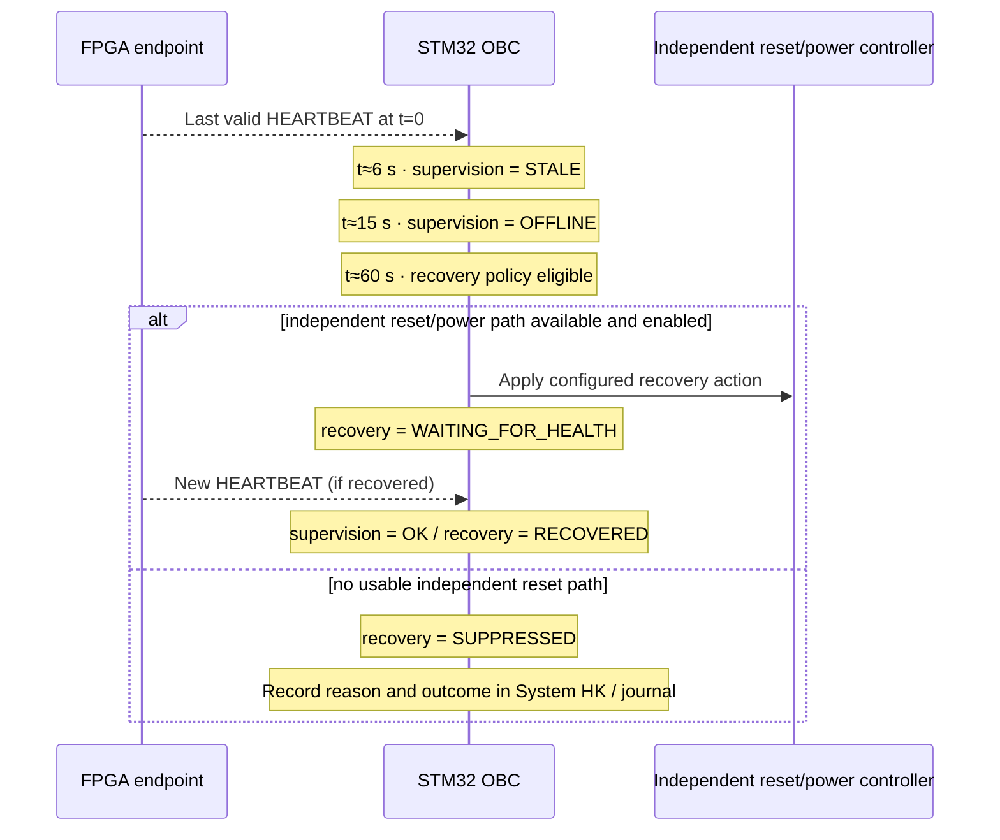

# STM32 OBC Device/Service ICD

This document is the normative EXN ICD for the STM32 OBC endpoint.

Common PUS-C packet rules are defined in `../ICD.md`, service semantics in `../services.md`, shared component behavior in `../component-services.md`, and the Pi UART and KV260 USB CDC-ACM control links in [`inter-node-links.md`](inter-node-links.md). STM32 **USART1 / AF7 on PB6 TX / PB7 RX** serves the Pi 5 through the qualified DAS board route; **CN13 USB OTG FS in device mode** serves the KV260's PS USB-A Linux host. Bounded COBS framing, USB device enumeration/stream queues, CRC validation and bench qualification remain implementation work. The OBC does **not** need a TCP/IP stack, wired Ethernet or an FPGA PL UART for this reference topology.

## 1. Identity and role

| Item | Value |
|---|---|
| APID | `0x100` |
| PUS-C source/destination ID | `0x0001` |
| PUS revision | C |

The OBC is the **spacecraft platform authority**: spacecraft-mode owner, command authority, component/subsystem orchestrator, System-HK aggregator, time authority and health/FDIR supervisor.

The intended implementation baseline is HardRT 0.5.1 + DAS v0.1.0 on STM32H755 / NUCLEO-H755ZI-Q. **CM7 is the authoritative HardRT OBC core.** A later **optional CM4 asynchronous computation worker** may execute explicitly delegated noncritical jobs using bounded internal shared-memory IPC. CM7 retains command admission, PUS-C verification, time, HK, mission state and acceptance of computed results. **CM4 is internal to OBC APID `0x100`**, not a new PUS endpoint or spacecraft controller. The OBC P0 build and Ground↔Pi Antenna path shall boot and operate with CM4 disabled/unavailable; CM4 boot/HSEM/shared-memory support is an independent feature gate. No new mission-visible fields, service codes or verification rules are allocated by this internal execution decision. See the [EXN architecture](../architecture.md#optional-internal-stm32-cm4-worker).

The STM32H755 is used to model the **OBC architectural role**, not to claim a flight-qualified OBC implementation. Its dual-core Cortex-M7/M4 resources are more than sufficient for the current EXN command/data-handling demonstrator and for representative distributed-subsystem orchestration. Flight deployment would additionally depend on mission-specific radiation tolerance, redundancy, memory protection, watchdog/recovery, interface, qualification and availability requirements.

## 1.1 Spacecraft-authority scope

The OBC authority extends beyond the payload services currently implemented by EXN.

Future examples include:

- AOCS/ADCS: OBC owns spacecraft attitude/mode objectives and supervision; a dedicated controller may execute estimation and fast actuator loops.
- EPS: OBC owns spacecraft power policy/mode; dedicated power electronics/controllers perform local switching and protection.
- Thermal: OBC owns thermal mode/policy; local controllers may execute heater loops.
- Mechanisms/actuators: OBC authorizes and supervises operations; local electronics may close low-level loops.
- HPC/payload computers: OBC authorizes jobs and use of results; HPC execution does not confer spacecraft authority.

These future interfaces are intentionally **not allocated service IDs yet**. EXN shall define them centrally when they become implementation scope rather than reserving speculative packet semantics now.

## 2. Packet behavior

The OBC:

- receives Ground-directed TCs at APID `0x100`;
- produces OBC TMs with APID `0x100`;
- emits downstream TCs with the target endpoint APID and PUS-C Source ID `0x0001`;
- consumes target TMs while preserving their producer APID;
- maintains CCSDS sequence counters and PUS-C TM message-type counters per required stream.

All OBC packet handling uses PUS Revision C.

## 3. Ground-routed command handling

For a routed Ground request, the OBC consumes the routing envelope defined in `gs.md`:

```text
transaction_id:u16
target:u8
options:u8
target_payload[...]
```

The OBC shall:

1. validate the Ground TC and Service 1 acceptance semantics;
2. authorize/validate the target operation;
3. remove the routing envelope;
4. construct a new PUS-C TC for the target endpoint;
5. track downstream verification/results against `transaction_id`;
6. forward/report the result to Ground according to the operation and options.

The OBC shall not forward malformed or unauthorized requests merely because the APID exists.

## 4. Endpoint registry and supervision

The OBC's **potential** subordinate endpoint catalogue is:

- PI-CAM;
- FPGA;
- Antenna / PI-COMMS;
- PI-MGMT.

**Only endpoints enabled/installed in the selected deployment are registered for liveness supervision.** The P0 OBC+Pi Ground profile requires PI-COMMS `0x103`; PI-CAM, FPGA `0x102` and PI-MGMT may be absent at this milestone. FPGA absence shall not stop CM7 boot, UART, local OBC HK or Ground communication. A configured/expected endpoint that disappears remains registered and is supervised as a failure; disabling a failed endpoint must be an explicit configuration/operational action, never an automatic masking of faults. This uses the existing endpoint registry and PUS wire profile, with no new supervision enum. See [deployment profiles](inter-node-links.md#integration-deployment-profiles-and-priorities).

Per endpoint the OBC tracks:

- OBC supervision state `UNKNOWN/OK/STALE/OFFLINE/ERROR`;
- last heartbeat/reply time;
- last self-reported common endpoint state;
- software version;
- time-sync state;
- active alarms;
- last error;
- restart/reset count;
- cached HEARTBEAT/HEALTH/SENSORS/LINKS structures and their sample ages.

Normative default supervision parameters are defined in `../component-services.md` and exposed through Service 20.

Default integration policy (all values are configurable with OBC Service 20):

| Policy | Integration default |
|---|---:|
| HEARTBEAT request interval | 2 s |
| HEALTH request interval | 10 s |
| Transition to STALE | 3 missed heartbeats |
| Transition to OFFLINE | 15 s unavailable |
| Automatic recovery eligible | 60 s unavailable |
| Recovery cooldown | 120 s |
| Automatic recovery attempt limit | 3 |

Example for a non-responsive FPGA:



A software reboot is only possible while a management path remains responsive. Recovery of a totally unreachable Pi/FPGA requires an independent reset or power-control path, which belongs to future platform/EPS integration.

## 5. Housekeeping

### 5.1 OBC one-shot HK

Ground or another authorized endpoint requests OBC HK with `TC[3,27]`. OBC returns `TM[3,25]` using the common HEARTBEAT/HEALTH/SENSORS/LINKS structures from `../component-services.md`.

OBC SENSORS shall include only values actually measurable through the selected STM32/DAS implementation, for example MCU internal temperature/reference channels once implemented.

### 5.2 System HK

System HK is OBC-owned:

- `TC[3,128]` Request System HK — **empty Application Data**;
- `TM[3,129]` System HK Report — complete current spacecraft snapshot.

The OBC continuously maintains the latest required HK structures for every **configured/registered** endpoint as part of normal supervision. An absent optional FPGA is not an OFFLINE record in the P0 profile; a previously responsive, still-configured FPGA that disconnects must remain visible. A Ground System-HK request serializes that cache; it does not normally initiate a fresh request fan-out.

The OBC includes itself plus every registered subordinate endpoint, even when an endpoint is stale or offline. For each endpoint it reports:

- OBC supervision state;
- last self-reported endpoint state;
- cached structure IDs;
- age of each cached structure;
- cached structure data when available.

This makes non-response an explicit spacecraft state rather than a reason to omit the component or delay the Ground response.

The complete wire layout is defined in `gs.md`.

## 6. Service 5 events

OBC event IDs occupy `0x1000..0x1FFF`.

Initial OBC event allocation:

| Event ID | Event | Severity |
|---:|---|---|
| `0x1001` | OBC boot completed | 5/1 informative |
| `0x1010` | endpoint supervision STALE | 5/2 low |
| `0x1011` | endpoint supervision OFFLINE | 5/3 medium |
| `0x1012` | endpoint supervision restored | 5/1 informative |
| `0x1020` | recovery policy triggered | 5/2 low |
| `0x1021` | recovery action sent | 5/1 informative |
| `0x1022` | recovery succeeded | 5/1 informative |
| `0x1023` | recovery failed | 5/3 or 5/4 according to endpoint criticality |
| `0x1024` | recovery suppressed / reset path unavailable | 5/3 medium |
| `0x1030` | watchdog reset detected | 5/4 high |
| `0x1040` | time synchronization lost | 5/2 or 5/3 according to duration |

Event payload format is the common Service 5 model in `../component-services.md`.

## 7. Service 8 component management

Representative Service 8 operations are:

| Requesting authority | Target endpoint | Operation |
|---|---|---|
| OBC | PI-MGMT | Restart Camera or Antenna service |
| OBC | PI-MGMT | Reboot Raspberry Pi |
| OBC | FPGA | Reinitialize processing service, if responsive |
| Ground via Antenna | OBC | Authorized OBC reboot |

See the [Camera recovery sequence](../diagrams.md#9-restart-failed-camera-service).

A Pi mission-service restart is addressed to PI-MGMT, not to the failing service itself.

The OBC also owns a bounded recovery journal. Ground can request creation of a diagnostic-log object using common Service 8 function `0x0006 CREATE_DIAGNOSTIC_LOG`; the resulting Service 220 object contains supervision/recovery history suitable for post-mortem analysis.

## 8. Service 9 time authority

The OBC maintains:

- `monotonic_ms:uint64`: milliseconds since OBC boot, never stepped backwards;
- `unix_ms:uint64`: synchronized Unix-epoch milliseconds.

Ground synchronizes the OBC with `TC[9,128] Set Mission Time`.

OBC propagates that command to PI-CAM, FPGA, Antenna and PI-MGMT after synchronization and periodically according to Service 20 policy.

PUS-C OBC telemetry uses the normative CUC timestamp defined in `../ICD.md`.

## 9. Service 12 monitoring

The OBC consumes endpoint monitoring/alarm state and also monitors its own declared health values.

Monitoring covers actual available measurements and operational health conditions only. Threshold values are Service 20 configuration parameters.

The OBC records active alarms in System HK and emits Service 5 events on relevant transitions.

## 10. Service 20 runtime configuration

Service 20 contains OBC **settings**, not actions.

Initial OBC parameters are defined in `../component-services.md`, including:

- heartbeat period;
- health-report period;
- missed-heartbeat limit;
- automatic-recovery enable;
- time resynchronization period;
- maximum accepted synchronization age;
- default transfer chunk size.

Restarting a component, synchronizing time, starting Camera acquisition, or submitting an FPGA job is not Service 20.

## 11. Camera orchestration

The OBC shall be able to:

- query Camera capabilities;
- set/get the batched Service 200 Camera configuration;
- start/stop acquisition;
- inspect acquisition status;
- list Camera products;
- command a Camera object to OBC, FPGA or Ground.

Bulk Camera data does not pass through OBC unless OBC itself is the selected destination.

## 12. FPGA orchestration

The OBC shall be able to:

- query Service 210 processing capabilities;
- submit/cancel jobs;
- query job status;
- consume small decision results;
- command large result objects to OBC, Camera or Ground.

The OBC does not compile in assumptions about the final FPGA algorithms; it uses advertised operation IDs.

## 13. Payload-transfer registry

For every OBC-commanded Service 220 transfer the OBC tracks:

```text
transfer_id
source_endpoint
object_id
destination
expected_size
started_unix_ms
state
result
```

Ground downlink is OBC-controlled but source-to-Antenna: the OBC instructs Camera or FPGA to transfer a specific object, then its producer delivers the bulk bytes through Antenna to Ground. See [data-plane routing](../architecture.md#52-data-plane).

## 14. Software management

The OBC coordinates Service 230 inventory/update operations.

It may manage:

- OBC firmware;
- PI-CAM;
- Antenna;
- PI-MGMT;
- FPGA node software;
- FPGA bitstream/model bundle where supported.

Package bytes use Service 220. Activation/rollback state uses Service 230. An update is successful only after post-activation heartbeat/HK validation.

## 15. PUS-C construction

OBC TCs use `PUS:revC:TC`, Source ID `0x0001`, CRC16 and command-specific verification flags.

OBC TMs use `PUS:revC:TM`, the appropriate destination ID, message-type counter and the normative CUC timestamp.

The OBC shall not implement PUS-A packet paths or legacy Service 17/23/250 semantics.
